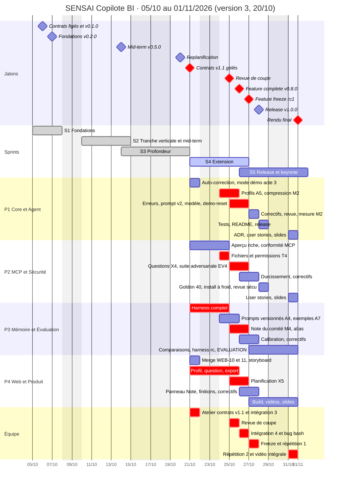
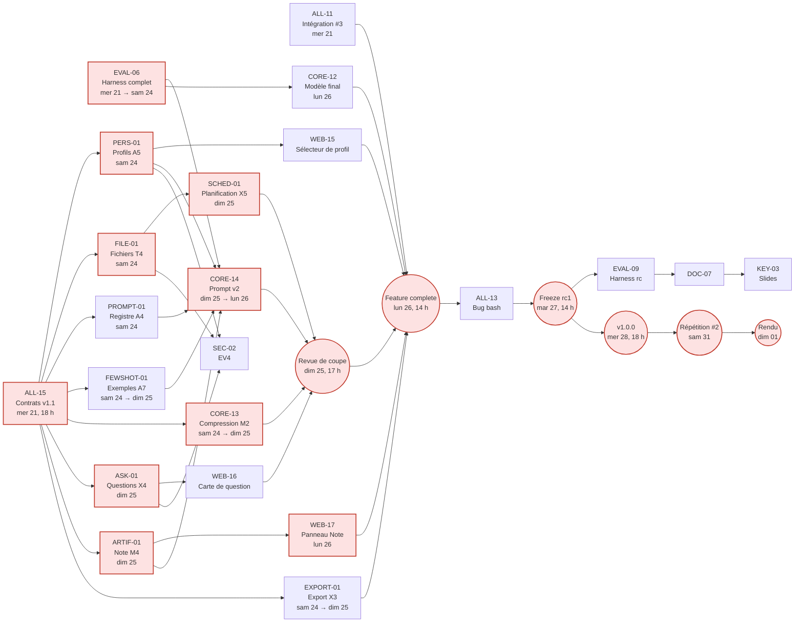

# PLANNING — SENSAI · Copilote BI & SQL

> Plan de réalisation pour une équipe de 4, du **lundi 05/10/2026** au **dimanche 01/11/2026**.
> **Version 3 — replanification du mardi 20/10**, après la mid-term : le périmètre passe de 6 à **16 fonctionnalités** (décision D-01 dans [`docs/decisions.md`](docs/decisions.md)), **les week-ends sont travaillés**, et les jeudis et vendredis restent en entreprise.
> Les sprints 1 et 2 (§7) et la définition des 60 % de la mid-term (§8) sont conservés tels quels, comme historique.
> Le contenu technique est dans **[PROJECT.md](PROJECT.md)** (§6.8 à §6.17 pour les nouvelles fonctionnalités), les fiches dans **[TASKS.md](TASKS.md)**, les interfaces ajoutées dans **[docs/contracts/v1.1-extensions.md](docs/contracts/v1.1-extensions.md)**. Ce document dit **qui fait quoi, quel jour, dans quel ordre, et comment on sait que c'est fini**.

---

## Sommaire

1. [Synthèse](#1-synthèse)
2. [Organisation de l'équipe](#2-organisation-de-léquipe)
3. [Matrice RACI](#3-matrice-raci)
4. [Travailler séparément sans se bloquer](#4-travailler-séparément-sans-se-bloquer)
5. [Rituels et outillage](#5-rituels-et-outillage)
6. [Calendrier, jalons et plan jour par jour](#6-calendrier-jalons-et-plan-jour-par-jour)
7. [Backlog détaillé par sprint](#7-backlog-détaillé-par-sprint)
8. [Mid-term : définition des 60 % (historique)](#8-mid-term--définition-des-60--historique)
9. [Rendu final : critères de sortie](#9-rendu-final--critères-de-sortie)
10. [Chemin critique et dépendances](#10-chemin-critique-et-dépendances)
11. [Charge, marge et plan de coupe](#11-charge-marge-et-plan-de-coupe)
12. [Suivi d'avancement](#12-suivi-davancement)
13. [Checklist de livraison](#13-checklist-de-livraison)

---

## 1. Synthèse

### 1.1 Point sur le dépôt (mardi 20/10, 23 h)

Constaté sur le dépôt distant, synchronisé le 20/10 à 22 h 48. Le travail resté en local n'est pas visible : **chacun pousse ses branches avant l'atelier du mercredi 21/10 à 9 h 30**, et ce tableau est corrigé en séance.

| Élément | État |
|---|---|
| `main` | `9fcc316` du 13/10 : tag `v0.5.0` et documentation de la mid-term. **Rien n'a été mergé depuis la soutenance** |
| Qualité de `main` | 1 099 tests passent, 1 ignoré (`pytest -m "not ollama and not external"`, Python 3.12, Linux) ; `ruff check` et `ruff format --check` propres. Tests du front (Vitest) non relancés pour ce point |
| Poussé depuis le 14/10 | `feat/WEB-10-model-selector-status-bar` et `feat/WEB-11-memory-panel` (15/10, P4, empilées) : 23 fichiers, +1 096 lignes, **non mergées**, sans conflit avec `main` |
| Sprint 3 (14/10 → 21/10) | 30 tâches individuelles prévues (hors bonus) : **2 arrivées sur le dépôt** depuis le 14/10 (WEB-10, WEB-11) ; EVAL-06a avait été mergée en partie avant la mid-term. Aucune branche de P1, P2 ou P3 poussée depuis le 13/10 |
| Absent de `main` | Compteur d'auto-correction SQL (CORE-09), troncature ou compression du contexte (CORE-13, `history.py` l'annonce), mode démo de l'acte 3 (décision S-1 du scénario), `make demo-reset` (CORE-19), comptage des clients protégés dans l'aperçu (HITL-03, `count: null`), exécution du harness sur le moteur réel (EVAL-06 : `sensai eval` ne fait encore que `compare`) |
| Documentation | `docs/adr/` vide ; pas encore de `docs/EVALUATION.md` ni de `docs/SECURITY.md`. Créés le 20/10 : `docs/decisions.md`, `docs/midterm-feedback.md`, `docs/contracts/v1.1-extensions.md`, user stories des 10 nouvelles fonctionnalités |
| Hygiène | `subject/` (PDF du sujet) est non suivi : ne pas le committer (à ajouter au `.gitignore`). 46 branches distantes déjà mergées peuvent être supprimées |

**Avancement pondéré** (§12) : ≈ **78 %** du périmètre initial, mais ≈ **40 %** du nouveau périmètre de 16 fonctionnalités.

### 1.2 Le calendrier réel

| Semaine | Lun | Mar | Mer | Jeu | Ven | Sam | Dim |
|---|---|---|---|---|---|---|---|
| 05 → 11/10 | 🟩 05 · kickoff | 🟩 06 · contrats figés, `v0.1.0` | 🟩 07 · intégration #1 | 🏢 08 | 🏢 09 | 🟨 10 · push | 🟨 11 · push |
| 12 → 18/10 | 🟩 12 | 🟩 13 · freeze 16 h | 🎯 14 · mid-term | 🏢 15 | 🏢 16 | ⬜ 17 | ⬜ 18 |
| 19 → 25/10 | 🟩 19 | 🟩 20 · **replanification** | 🟩 21 · **atelier contrats v1.1**, intégration #3 | 🏢 22 | 🏢 23 | 🟨 24 · **push extension** | 🟨 25 · push, **revue de coupe** |
| 26/10 → 01/11 | 🟩 26 · **feature complete**, bug bash | 🟩 27 · **freeze `rc1`** | 🟩 28 · **`v1.0.0`**, vidéos par acte | 🏢 29 | 🏢 30 | 🟨 31 · répétition #2, vidéo intégrale | 🏁 01 · rendu |

🟩 jour d'école · 🟨 week-end travaillé · 🎯 soutenance · 🏢 entreprise (rien de planifié) · ⬜ non planifié · 🏁 échéance

**Conséquence** : à partir du mercredi 21/10, il reste **7 jours de travail et une matinée** (mer 21, sam 24, dim 25, lun 26, mar 27, mer 28, sam 31, dim 01 matin). Le feature freeze ne bouge pas (mardi 27/10, 14 h) : **les nouvelles fonctionnalités se construisent le mer 21, le sam 24, le dim 25 et le lun 26 au matin**, soit ≈ 23 h par personne.

### 1.3 Hypothèses de capacité (mises à jour le 20/10)

| # | Hypothèse | Capacité par personne |
|---|---|---|
| H1 | Lundi, mardi, mercredi : journée consacrée au projet | 8 h / jour |
| H2 | Jeudi, vendredi : entreprise | 0 h, aucune réunion, aucune revue de PR attendue |
| H6 | **Sam 24, dim 25 et sam 31/10 travaillés** (décision D-02) | 8 h / jour |
| H7 | Dim 01/11 : rendu | 3 h (relecture, dépôt) |

**Du mer 21/10 au dim 01/11 : 59 h par personne**, dont **≈ 16 h de temps collectif** (atelier, intégrations, revue de coupe, bug bash, répétitions, rendu) et **≈ 43 h de tâches individuelles**. La charge planifiée est de **37 à 40 h** (86 à 93 %, §11).

> ⚠️ **H6 conditionne l'extension.** Un week-end non travaillé retire 16 h par personne : appliquer alors le plan de coupe (§11.3) au moins jusqu'à la ligne 5.

### 1.4 Jalons

| Jalon | Date | Critère | État |
|---|---|---|---|
| J0 · Kickoff | lun 05/10 | Rôles attribués, dépôt et Kanban créés | ✅ |
| J1 · Contrats figés + base loop | mar 06/10 | `docs/contracts/` figés, `v0.1.0` | ✅ |
| J2 · Fondations intégrées | mer 07/10 | `v0.2.0` | ✅ |
| J3 · Code freeze mid-term | mar 13/10, 16 h | `v0.5.0` | ✅ |
| J4 · Mid-term defense | mer 14/10 | Retour du jury : ajouter des fonctionnalités | ✅ |
| J5 · Replanification | mar 20/10 | Ce document, décisions D-01 à D-07, contrats v1.1 en proposition | ✅ |
| **J6 · Contrats v1.1 gelés** | **mer 21/10, 18 h** | Proposition validée ; chaque propriétaire a ouvert sa PR de contrat | |
| **J7 · Revue de coupe** | **dim 25/10, 17 h** | Chaque fonctionnalité est « mergée », « en bonne voie » ou « coupée » (D-07), décision écrite | |
| **J8 · Feature complete** | **lun 26/10, 14 h** | Toutes les fonctionnalités retenues sur `main`, les 5 actes jouables ; tag `v0.8.0` | |
| **J9 · Feature freeze** | **mar 27/10, 14 h** | Tag `v1.0.0-rc1` | |
| **J10 · Release** | **mer 28/10, 18 h** | Tag `v1.0.0`, vidéos par acte enregistrées, checklist §13 cochée | |
| J11 · Répétition générale | sam 31/10, 17 h | Répétition #2 chronométrée, vidéo intégrale | |
| **J12 · Rendu final + keynote** | **dim 01/11** | Dépôt complet, keynote prête | |

### 1.5 Cinq sprints

| Sprint | Dates | Contenu du créneau | Capacité tâches / pers. | État |
|---|---|---|---:|---|
| S1 · Fondations | lun 05/10 → mer 07/10 | 3 jours d'école | 18 h | ✅ |
| S2 · Tranche verticale et mid-term | sam 10/10 → mer 14/10 (matin) | push du week-end + 2 jours + soutenance | 19,5 h | ✅ |
| S3 · Profondeur | mer 14/10 (après-midi) → mar 20/10 | ½ journée + 2 jours | — | Clos le 20/10 ; reliquat reporté en S4 et S5 (§7) |
| **S4 · Extension** | **mer 21/10 → lun 26/10 (14 h)** | mer + sam + dim + lun matin | **≈ 27 h** | |
| **S5 · Release et keynote** | **lun 26/10 (14 h) → dim 01/11** | bug bash, freeze, mesures, documentation, répétitions | **≈ 16 h** | |

### 1.6 Ce qui change dans cette version (v3)

- **+10 fonctionnalités** (D-01) : EV4, T4, M2, A4 (niveau 1, à moitié prévues) ; A5, X4, X5, X3, A7, M4 (niveau 2). 11 → 24 ★.
- **Week-ends travaillés** (D-02). Le GO / NO-GO du 21/10 disparaît ; la **revue de coupe du dim 25/10 à 17 h** le remplace.
- **MCP-08 remplacée par FILE-01** (T4, D-03). **Coupées** : CORE-16, WEB-12. **Réduites** : MEM-05 (alias), EVAL-08 (recentrée), MCP-07, HITL-03, CORE-12, CORE-15, CORE-18, SEC-03, OPS-01, WEB-13 (D-05).
- **Nouveaux jalons** : contrats v1.1 (21/10), revue de coupe (25/10), feature complete `v0.8.0` (26/10). Freeze et release inchangés.
- Vidéos par acte : mar 27 → **mer 28/10**. Répétition #2 et vidéo intégrale : mer 28 → **sam 31/10**.
- Noms renseignés d'après les initiales des commits : **P1 G.WI, P2 T.BE, P3 L.BA, P4 A.P**.

---

## 2. Organisation de l'équipe

Chaque rôle possède des fonctionnalités **de bout en bout** (code, tests, user stories, slide de keynote). Les ajouts du 20/10 sont en gras.

### P1 — Lead Core & Agent · *G.WI*

- **Possède** : B1 (base loop), moteur et boucle d'agent, T5 (sorties structurées), contenu des prompts, configuration, CLI, intégration et releases ; **M2 (budget de tokens et compression)**, **A5 (profils d'agent)**, **mode démo de l'acte 3**.
- **Livrables clés** : `core/`, `llm/`, `cli/`, `personas/`, tags de version, README.
- **Rôle transverse** : tech lead. Anime l'atelier contrats v1.1, arbitre les conflits d'interface, tient la revue de coupe et décide du contenu des freezes.

### P2 — Outils, MCP & Sécurité · *T.BE*

- **Possède** : T1 (client MCP, `sql-toolbox`, serveur existant), A3 (politique HITL, aperçu d'impact, audit), base de démonstration, SQL de référence du golden set ; **EV4 (suite adversariale)**, **T4 (outils fichiers et permissions)**, **X4 (`ask_user` et pause question)**.
- **Livrables clés** : `mcp/`, `mcp_servers/`, `tools/policy.py`, `tools/file_*.py`, `core/ask.py`, `data/`, `docs/SECURITY.md`, `eval/adversarial.jsonl`.

### P3 — Mémoire & Évaluation · *L.BA*

- **Possède** : M3 (mémoire structurée), EV1 (juge, contrôle numérique, harness, calibration), golden set ; **A4 (registre de prompts)**, **A7 (exemples dynamiques)**, **M4 (note du comité, côté moteur)**.
- **Livrables clés** : `memory/`, `documents/`, `eval/`, `tools/memory_tools.py`, `tools/document_tools.py`, `core/fewshot.py`, `core/prompts/registry.toml`, `docs/EVALUATION.md`.

### P4 — Web & Produit · *A.P*

- **Possède** : X1 (backend FastAPI/WebSocket + front React), expérience utilisateur des fonctionnalités des autres ; **X3 (export et partage)**, **X5 (tâches planifiées)**, **interfaces de A5 (sélecteur de profil), X4 (carte de question) et M4 (panneau Note)** ; scénario et supports de keynote.
- **Livrables clés** : `src/sensai/web/` (dont `export.py`, `scheduler.py`), `web/`, `docs/keynote/`, vidéos de secours.
- **Rôle transverse** : product owner. Garant du scénario (version 2, 15 minutes) et de la cohérence des user stories.

---

## 3. Matrice RACI

R = réalise · A = responsable final (un seul par ligne) · C = consulté · I = informé

| Bloc | P1 | P2 | P3 | P4 |
|---|:---:|:---:|:---:|:---:|
| B1 Base loop, moteur, configuration | **A/R** | C | C | I |
| T5 Sorties structurées | **A/R** | I | C | I |
| T1 Client MCP, `sql-toolbox`, serveur existant | R (MCP-06) | **A/R** | I | I |
| A3 Politique HITL et aperçu d'impact | R (pause moteur) | **A/R** | I | R (modale) |
| M3 Mémoire structurée | C (injection prompt) | I | **A/R** | R (panneau) |
| EV1 Juge, harness, calibration | C (choix du modèle) | R (golden 40) | **A/R** | C (badges) |
| X1 Web UI | C (contrat événements) | I | I | **A/R** |
| EV4 Suite adversariale | C | **A/R** | C (harness) | I |
| T4 Fichiers et permissions | C | **A/R** | I | R (affichage) |
| M2 Budget de tokens et compression | **A/R** | I | C (mesure) | R (jauge, marqueur) |
| A4 Prompts versionnés | R (prompt v2) | I | **A/R** | I |
| A5 Profils d'agent | **A/R** | R (politique) | I | R (sélecteur) |
| X4 Questions de précision | R (pause moteur) | **A/R** | I | R (carte) |
| X5 Tâches planifiées | C (moteur) | C (permissions) | I | **A/R** |
| X3 Export et partage | I | I | C (note) | **A/R** |
| A7 Exemples dynamiques | C (prompt v2) | I | **A/R** | I |
| M4 Note du comité | C (prompt v2) | I | **A/R** | R (panneau) |
| Base de démo et golden set | I | **A/R** (base) | R (golden set) | I |
| Contrats d'interface (v1 et v1.1) | **A** | R | R | R |
| README, ADR, documentation | **A** | R | R | R |
| User stories | R | R | R | **A** |
| Keynote, slides, vidéos | R | R | R | **A** |
| Intégration continue et releases | **A/R** | C | C | C |

---

## 4. Travailler séparément sans se bloquer

### 4.1 Contrats d'abord

Les contrats v1 (figés le 06/10) restent la référence. Les ajouts des dix fonctionnalités sont rédigés dans **[`docs/contracts/v1.1-extensions.md`](docs/contracts/v1.1-extensions.md)**, validés à l'atelier **ALL-15 du mer 21/10 à 9 h 30**, et **gelés à 18 h**. Chaque propriétaire reporte ensuite sa partie dans le contrat officiel par une PR dédiée, avant de coder.

| Partie du contrat v1.1 | Propriétaire | Consommateurs | PR de contrat |
|---|---|---|---|
| Configuration (`[context]`, `[fewshot]`, `[files]`, `[documents]`, `[schedules]`, `[demo]`, `[agent] persona` / `prompt_version`) | P1 | Tous | mer 21/10 après-midi |
| Événements `context_compacted`, `examples_injected`, `question_asked`, `question_answered`, `document_updated` et nouveaux codes | P1 | P3, P4 | mer 21/10 après-midi |
| Politique avec profil actif, `QuestionBroker`, outils `ask_user` et `file_*`, `impact.file` | P2 (P1 pour la politique) | P1, P4 | mer 21/10 après-midi |
| Outils `document_*` et tables de la note, banque d'exemples, registre des prompts | P3 | P1, P4 | mer 21/10 après-midi |
| WebSocket (`answer`, `set_persona`, `share`, `unshare`, `run_schedule` et réponses) et routes REST | P4 | P1 | mer 21/10 après-midi |

**Règle de modification après le gel** : une PR dédiée sur `docs/contracts/`, approuvée par le propriétaire **et** par chaque consommateur concerné. Pendant le push du week-end, un changement de contrat n'est accepté que s'il **bloque** quelqu'un, et il est annoncé dans `#contrats`.

### 4.2 Des bouchons pour avancer sans attendre

| Qui | Dépend de | Bouchon utilisé | Fourni par | Disponible |
|---|---|---|---|---|
| P4 (sélecteur de profil, carte de question, panneau Note, export, planification) | PERS-01, ASK-01, ARTIF-01, moteur | `MockEngine` + nouvelles fixtures dans `tests/fixtures/events/` (`question.jsonl`, `persona.jsonl`, `document.jsonl`, `compaction.jsonl`), écrites d'après les contrats v1.1 | P4, validées par P1 | sam 24/10, 10 h |
| P1 (prompt v2, CORE-14) | FEWSHOT-01, ARTIF-01, PERS-01 | Emplacements `$examples`, `$persona` et plan de la note remplis par des valeurs vides | P1 | sam 24/10 |
| P2 (SEC-02, nouvelles attaques) | FILE-01, PERS-01, ASK-01, ARTIF-01 | Tests écrits d'après les contrats, marqués `xfail` jusqu'à la fusion de chaque fonctionnalité | P2 | dim 25/10 |
| P3 (EVAL-08) | PROMPT-01, FEWSHOT-01 | Options `--prompt-version` et `fewshot_enabled` | P3 | lun 26/10 |
| P4 (SCHED-01) | FILE-01 | `FilePermissions` réel si mergé, sinon écriture directe sous `reports/planifie/` en attendant | P2 | dim 25/10 |

### 4.3 Propriété des dossiers (`CODEOWNERS`)

```text
/src/sensai/core/            @P1
/src/sensai/llm/             @P1
/src/sensai/cli/             @P1
/personas/                   @P1
/src/sensai/core/ask.py      @P2 @P1
/src/sensai/core/fewshot.py  @P3
/src/sensai/core/prompts/registry.toml @P3 @P1
/src/sensai/tools/registry.py @P1 @P2
/src/sensai/tools/policy.py  @P2
/src/sensai/tools/file_permissions.py @P2
/src/sensai/tools/file_tools.py @P2
/src/sensai/mcp/             @P2
/src/sensai/mcp_servers/     @P2
/src/sensai/data/            @P2
/src/sensai/data/examples.jsonl @P3
/src/sensai/memory/          @P3
/src/sensai/documents/       @P3
/src/sensai/tools/memory_tools.py @P3
/src/sensai/tools/document_tools.py @P3
/src/sensai/eval/            @P3
/eval/                       @P3
/eval/adversarial.jsonl      @P2
/src/sensai/web/             @P4
/web/                        @P4
/docs/keynote/               @P4
/docs/contracts/             @P1 @P2 @P3 @P4
```

### 4.4 Points d'intégration planifiés

| Date | Intégration | Objectif |
|---|---|---|
| mer 07/10, 15 h 30 | #1 (ALL-04) | ✅ `v0.2.0` |
| mar 13/10, 13 h | #2 (ALL-06) | ✅ scénario mid-term, freeze `v0.5.0` |
| **mer 21/10, 14 h** | **#3 (ALL-11)** | WEB-10, WEB-11 et tout le travail local du sprint 3 sur `main`, CI verte |
| **dim 25/10, 17 h** | **Revue de coupe (ALL-16)** | État de chaque fonctionnalité, décision de coupe écrite |
| **lun 26/10, 14 h** | **#4 (ALL-17), feature complete** | Les 5 actes de bout en bout sur la machine de démo, tag `v0.8.0` |
| lun 26/10, 15 h | Bug bash (ALL-13) | Tout le monde teste le produit des autres |

En dehors de ces créneaux, on merge **en continu** (petites PR, CI verte), week-end compris.

### 4.5 Le rythme de fin de projet

Il n'y a plus que deux jours d'interruption par semaine (jeudi et vendredi), mais ils tombent juste après l'atelier contrats et juste après la release.

1. **Mercredi avant 18 h : tout ce qui est prêt est mergé**, et les contrats v1.1 sont gelés (21/10).
2. **Mercredi 18 h : état de passation** posté par chacun dans `#daily` (modèle ci-dessous). Samedi matin, chacun reprend par la « prochaine action précise » de sa passation.

   ```text
   Passation — <nom> — mer JJ/MM
   Mergé cette semaine : …
   En cours : <branche> — où j'en suis — prochaine action précise
   J'attends de : <qui> — <quoi> — pour <quand>
   Samedi 9 h, je reprends par : …
   ```

3. **Jeudi–vendredi** : aucune réunion, aucune revue attendue, notifications du projet coupées.
4. **Revues de PR** : délai cible de **4 h tous les jours travaillés, week-ends compris**. Une PR de plus de 400 lignes est découpée.
5. **Week-end** : on merge sur `main` dès que la CI est verte et qu'une relecture a eu lieu ; pas de modification de contrat sauf blocage (§4.1).
6. **Limite de travail** : 8 h par jour. Une tâche qui déborde est signalée au point suivant, pas rattrapée la nuit (risque R18).

---

## 5. Rituels et outillage

| Rituel | Quand | Durée | Contenu |
|---|---|---|---|
| Daily asynchrone | Chaque jour travaillé avant 9 h 30, canal `#daily` | 3 lignes | Fait hier · Prévu aujourd'hui · Bloquant |
| **Atelier contrats v1.1 + point du dépôt** (ALL-15) | **Mer 21/10, 9 h 30** | 1 h 30 | Chacun a poussé son travail local ; validation de la proposition v1.1 ; points V-1 à V-6 |
| Revue + passation (ALL-12) | Mer 21/10, 17 h | 45 min | Démo de ce qui est mergé, suivi §12, passation écrite (§4.5) |
| Point du push | Sam 24/10, 10 h (visio) | 15 min | Qui fait quoi, merges prévus, blocages |
| **Revue de coupe** (ALL-16) | **Dim 25/10, 17 h** | 1 h | État de chaque fonctionnalité, décision de coupe (§11.3) |
| Point du lundi | Lun 26/10, 9 h | 30 min | Chemin vers la feature complete de 14 h |
| Rétrospective finale | Après le rendu | 1 h | Ce qui a marché, ce qu'on referait autrement (nourrit le bilan de la keynote si elle a lieu après) |
| Jeudi–vendredi | — | — | **Aucun rituel** |

**Outillage**
- Tableau Kanban (Notion ou GitHub Projects) : *À faire → En cours → En revue → Bloqué → Terminé*. Une carte = un ID de ce planning. **Limite : 2 cartes « En cours » par personne.**
- Discord : `#daily`, `#blocages`, `#contrats`, `#demo`.
- Règle d'escalade : bloqué depuis plus de **2 h** un jour travaillé → message dans `#blocages` en mentionnant l'owner concerné.

**Definition of Ready** : dépendances terminées ou bouchonnées, contrat v1.1 connu, critère de fin écrit sur la carte.

**Definition of Done** : voir PROJECT.md §13.3 (mergé, CI verte, testé, documenté, démontrable) ; **pour une fonctionnalité de l'extension, ses 2 user stories ont au moins un critère vérifié** (D-07).

---

## 6. Calendrier, jalons et plan jour par jour

### 6.1 Diagramme de Gantt

Les jeudis et vendredis sont exclus du diagramme (entreprise), ainsi que le week-end non planifié du 17–18/10.



### 6.2 Plan jour par jour

Chaque case liste les tâches sur lesquelles la personne travaille ce jour-là ; **en gras**, celles qui doivent être **terminées** le soir même. Les lignes jusqu'au 18/10 sont l'historique de la version 2.

| Jour | P1 Core & Agent | P2 MCP & Sécurité | P3 Mémoire & Éval | P4 Web & Produit | Équipe |
|---|---|---|---|---|---|
| 🟩 lun 05/10 | **CORE-01** · CORE-02 | **DATA-01** · **MCP-01** · MCP-02 | **MEM-01** · **CORE-03** · EVAL-01 | **WEB-03** · WEB-02 | 9 h 00 · ALL-01 Kickoff<br>10 h 00 · ALL-03 Env.<br>10 h 30 · ALL-02 Atelier contrats |
| 🟩 mar 06/10 | **CORE-02** · **CORE-04** · CORE-05 | **MCP-02** · DATA-02 | **EVAL-01** · **EVAL-02** · MEM-02 | **WEB-02** · **WEB-01** · **KEY-00** · WEB-04 | 12 h 00 · contrats figés (J1)<br>soir · tag `v0.1.0` |
| 🟩 mer 07/10 | **CORE-05** · CORE-06 | **DATA-02** · MCP-03 | **MEM-02** · **EVAL-04** | **WEB-04** · WEB-05 | 15 h 30 · ALL-04 Intégration #1<br>17 h 00 · ALL-05 Revue + passation<br>tag `v0.2.0` (J2) |
| jeu 08/10 – ven 09/10 | 🏢 *entreprise* | | | | *Aucune réunion. Revues de PR non attendues.* |
| 🟨 sam 10/10 | **CORE-06** · CORE-08 | **MCP-03** · SEC-01 | EVAL-03 | **WEB-05** · WEB-06 | 14 h 00 · point visio 15 min<br>push mid-term (H3) |
| 🟨 dim 11/10 | **CORE-08** · CORE-07 | **SEC-01** · **MCP-04** · HITL-01 | **EVAL-03** · MEM-03 | **WEB-06** · **WEB-07** · KEY-01 | push mid-term (H3) |
| 🟩 lun 12/10 | **CORE-07** · **MCP-06** · **DOC-05** · **DOC-03** · CORE-10 | **HITL-01** · **HITL-02** · MCP-05 | **MEM-03** · **EVAL-05** · **MEM-04** · DOC-02 | **KEY-01** · **DOC-01** · **WEB-08** · WEB-09 | 9 h 00 · point du lundi |
| 🟩 mar 13/10 | **CORE-10** · CORE-09 | **MCP-05** · **DOC-04** · MCP-07 | **DOC-02** · **EVAL-02b** · EVAL-06a | **WEB-09** · WEB-10 | 13 h 00 · ALL-06 Intégration #2<br>16 h 00 · **ALL-07 code freeze `v0.5.0`**<br>16 h 30 · ALL-08 Répétition + vidéo |
| 🎯 mer 14/10 | **CORE-09** · CORE-11 | **MCP-07** · HITL-03 | **EVAL-06a** · EVAL-06 | **WEB-10** · WEB-11 | matin · ALL-08 répétition éclair<br>**ALL-09 Mid-term defense**<br>après · ALL-10 Rétro + replanning |
| jeu 15/10 – ven 16/10 | 🏢 *entreprise* | | | | *Aucune réunion. Revues de PR non attendues.* |
| ⬜ sam 17/10 – dim 18/10 | *tampon* | *tampon* | *tampon* | *tampon* | Rattrapage volontaire uniquement (H4) |
| 🟩 lun 19/10 – mar 20/10 | *réalisé : à renseigner à ALL-15* | *idem* | *idem* | *idem* | mar 20/10 soir · replanification v3 (J5) |
| 🟩 mer 21/10 | **CORE-09** · **CORE-20** | **HITL-03** · MCP-07 | EVAL-06 | **WEB-10 / WEB-11 (merge)** · **KEY-02** · WEB-15 | 9 h 30 · **ALL-15 atelier contrats v1.1 + point du dépôt**<br>14 h 00 · ALL-11 intégration #3<br>17 h 00 · ALL-12 revue + passation<br>18 h 00 · **contrats v1.1 gelés (J6)** |
| jeu 22/10 – ven 23/10 | 🏢 *entreprise* | | | | *Aucune réunion. Revues de PR non attendues.* |
| 🟨 sam 24/10 | **PERS-01** · CORE-13 | **FILE-01** · **MCP-07** | **EVAL-06** · **PROMPT-01** · FEWSHOT-01 | **WEB-15** · **WEB-16** · EXPORT-01 | 10 h 00 · point du push (visio, 15 min) |
| 🟨 dim 25/10 | **CORE-13** · **CORE-11** · CORE-14 | **ASK-01** · SEC-02 | **FEWSHOT-01** · **ARTIF-01** · MEM-05 | **EXPORT-01** · **SCHED-01** | 17 h 00 · **ALL-16 revue de coupe (J7)** |
| 🟩 lun 26/10 | **CORE-14** · **CORE-12** · **CORE-19** | SEC-02 · SEC-03 | **MEM-05** · **EVAL-07** | **WEB-17** · WEB-13 | 9 h 00 · point du lundi<br>14 h 00 · **ALL-17 intégration #4, feature complete `v0.8.0` (J8)**<br>15 h 00 · ALL-13 bug bash |
| 🟩 mar 27/10 | **FIX-P1** · **REV-01** · EVAL-10 | **FIX-P2** · **SEC-03** · SEC-02 (vrai modèle) | **FIX-P3** · EVAL-08 | **FIX-P4** · **WEB-13** · KEY-03 | 14 h 00 · **ALL-14 feature freeze `v1.0.0-rc1` (J9)**<br>14 h 30 · KEY-05 répétition #1 |
| 🟩 mer 28/10 | **CORE-15** · **DOC-08** · **REL-01** | **SEC-02** · **EVAL-02c** · **OPS-01** · **REV-02** · **DOC-06** | **EVAL-08** · **EVAL-09** · DOC-07 | **WEB-14** · **KEY-04** · KEY-03 | 9 h 00 · FIX-ALL (bloquants seulement)<br>14 h 00 · KEY-04 vidéos par acte<br>18 h 00 · **tag `v1.0.0` (J10)** |
| jeu 29/10 – ven 30/10 | 🏢 *entreprise* | | | | *Aucune réunion. Revues de PR non attendues.* |
| 🟨 sam 31/10 | **EVAL-10** · **CORE-18** · **DOC-09** · **DOC-11** | **DOC-04b** · *marge* | **DOC-07** · **DOC-10** | **KEY-03** · **DOC-12** · *marge* | matin · correctifs bloquants seulement (`v1.0.x`)<br>14 h 00 · **KEY-06 répétition #2 + vidéo intégrale (J11)** |
| 🏁 dim 01/11 | | | | | **Rendu** : relecture des supports, dépôt (J12) |

---

## 7. Backlog détaillé par sprint

Colonnes : **ID** (★ = chaîne critique) · **Tâche** · **Est.** (heures effectives) · **Quand** (début → fin) · **Dépend de** · **Critère de fin**.
Les spécifications techniques sont dans PROJECT.md (section entre crochets) et les fiches dans TASKS.md. Les sprints 1 et 2 sont l'historique de la version 2.

### Sprint 1 — Fondations · lun 05/10 → mer 07/10

**Objectif** : contrats figés mardi midi, base loop mardi soir, et chacun a sa brique de base sur `main` mercredi soir.

**Équipe**

| ID | Activité | Est. / pers. | Quand | Critère de fin |
|---|---|---|---|---|
| ALL-01 | Kickoff : lecture du sujet, validation du concept, attribution des rôles, **confirmation des hypothèses de capacité H1–H5**, création du dépôt, du Kanban et du Discord | 1 h | lun 05/10 · 9 h 00 | Rôles nommés, hypothèses confirmées, backlog importé dans le Kanban |
| ALL-03 | Validation de l'environnement de chacun (Python, Ollama + modèle téléchargé, `uv`, Node) | 0 h 30 | lun 05/10 · 10 h 00 | Chacun lance `ollama run <modèle>` et `uvx mcp-server-time` |
| ALL-02 | Atelier contrats (animé par P1) | 2 h | lun 05/10 · 10 h 30 | Brouillons dans `docs/contracts/`, figés mar 06/10 à 12 h |
| ALL-04 | Intégration #1 : tout sur `main`, CLI sur l'engine, web sur `MockEngine`, client MCP contre `mcp-server-time` | 1 h 30 | mer 07/10 · 15 h 30 | Branches mergées, écarts de contrat listés et corrigés, tag `v0.2.0` |
| ALL-05 | Revue du sprint 1 + planning du sprint 2 + **passation avant jeudi–vendredi** | 1 h | mer 07/10 · 17 h 00 | Suivi §12 à jour, chacun a posté son état de passation (§4.5) |

**P1 — Core & Agent**

| ID | Tâche | Est. | Quand | Dépend de | Critère de fin |
|---|---|---|---|---|---|
| CORE-01 | Squelette du dépôt : `pyproject`, requirements, ruff, pytest, CI, CODEOWNERS, modèle de PR, Makefile [§5.5, §13] | 2 h | lun 05/10 | ALL-01 | CI verte sur `main` |
| CORE-02 ★ | Client Ollama async : `/api/chat` en streaming NDJSON, `/api/tags`, `/api/show`, erreurs typées [§6.1] | 4 h | lun 05/10 → mar 06/10 | CORE-01 | Tests sur flux enregistrés verts |
| CORE-04 ★ | Base loop CLI : REPL, streaming, historique, commandes, entrée vide, Ctrl+C [§6.1] | 3 h | mar 06/10 | CORE-02, CORE-03 | Les 4 exigences B1 démontrées, tag `v0.1.0` |
| CORE-05 ★ | Engine headless : modèle d'événements, `ConfirmationBroker` (pause/reprise), CLI transformée en adaptateur [§5.1, §7.5] | 5 h | mar 06/10 → mer 07/10 | CORE-04, ALL-02 | La CLI ne fait plus qu'afficher des événements |

**P2 — MCP & Sécurité**

| ID | Tâche | Est. | Quand | Dépend de | Critère de fin |
|---|---|---|---|---|---|
| DATA-01 | Schéma `business.db` (DDL, index, décision sur les vues) [§8.1] | 2 h | lun 05/10 | ALL-02 | `business_schema.sql` mergé (contrat) |
| MCP-01 | Spike MCP time-boxé : lecture de la spec + script jetable `initialize` / `tools/list` / `tools/call` sur `mcp-server-time` [§6.3] | 2 h | lun 05/10 | ALL-03 | Script fonctionnel + note d'une page |
| MCP-02 ★ | Client MCP stdio générique : sous-processus, ids, `initialize`, `tools/list`, `tools/call`, timeouts, stderr, arrêt propre [§6.3] | 6 h | lun 05/10 → mar 06/10 | MCP-01 | Tests contre `mcp-server-time` verts |
| DATA-02 | Générateur déterministe relatif à la date de référence + motifs plantés [§8.2] | 4 h | mar 06/10 → mer 07/10 | DATA-01 | `make seed` produit deux fois la même base |

**P3 — Mémoire & Évaluation**

| ID | Tâche | Est. | Quand | Dépend de | Critère de fin |
|---|---|---|---|---|---|
| MEM-01 | Schéma `memory.db` + contrat des outils mémoire [§6.4] | 2 h | lun 05/10 | ALL-02 | `memory/schema.sql` + section de `tools.md` |
| CORE-03 | Configuration TOML + surcharges CLI/env, repli `tomli` en 3.10 [§7.3] | 2 h | lun 05/10 | CORE-01 | `config.example.toml` + tests de priorité |
| EVAL-01 | Schéma du rapport du juge + définitions des métriques [§7.4, §11.2] | 2 h | lun 05/10 → mar 06/10 | ALL-02 | `judge_report.v1.json` mergé |
| EVAL-02 | Golden set v0 : 15 questions + SQL de référence [§11.1] | 3 h | mar 06/10 | DATA-01 | `eval/golden.jsonl` (15 entrées exécutables) |
| MEM-02 | `MemoryStore` : CRUD entités/relations/faits/glossaire, audit, FTS5 [§6.4] | 6 h | mar 06/10 → mer 07/10 | MEM-01 | Tests CRUD + audit verts |
| EVAL-04 | Contrôle numérique déterministe (formats FR, unités, tolérance) [§6.6] | 3 h | mer 07/10 | — | Tests sur 20 cas de formats |

**P4 — Web & Produit**

| ID | Tâche | Est. | Quand | Dépend de | Critère de fin |
|---|---|---|---|---|---|
| WEB-03 | Maquettes basse fidélité : chat, timeline, SQL, résultats, modale HITL, badge, mémoire, barre d'état | 2 h | lun 05/10 | — | Maquettes dans `docs/keynote/ui/` validées en point |
| WEB-02 | Squelette React + Vite + TS, build servi par FastAPI [§6.7] | 3 h | lun 05/10 → mar 06/10 | CORE-01 | `make web` affiche la page |
| WEB-01 | Contrat WebSocket + 4 fichiers d'événements d'exemple (nominal, HITL, contradiction, erreur) [§7.1, §7.2] | 2 h | mar 06/10 | ALL-02 | `websocket.md` + `tests/fixtures/events/*.jsonl` |
| KEY-00 | Scénario keynote v1, personas, liste des questions de démo (repris de PROJECT §3) [§3] | 1 h | mar 06/10 | — | `docs/keynote/scenario.md` |
| WEB-04 | Backend FastAPI : `WS /ws/{session}`, `GET /api/health`, `/api/models`, `MockEngine` [§6.7] | 5 h | mar 06/10 → mer 07/10 | WEB-01 | Le front reçoit les événements rejoués |


> **J1 · mar 06/10** — Contrats figés à 12 h, `v0.1.0` le soir.
> **J2 · mer 07/10** — Fondations intégrées, `v0.2.0`, machine de démo de référence choisie, passation écrite.

---

### Sprint 2 — Tranche verticale et mid-term · sam 10/10 → mer 14/10

**Objectif** : le scénario mid-term fonctionne de bout en bout en CLI et en web le mardi 13/10 à 16 h.

**Équipe**

| ID | Activité | Est. / pers. | Quand | Critère de fin |
|---|---|---|---|---|
| ALL-06 | Intégration #2 : scénario mid-term de bout en bout sur la machine de démo (CLI + web) | 2 h | mar 13/10 · 13 h 00 | Scénario mid-term joué de bout en bout au moins une fois |
| ALL-07 | **Code freeze mid-term** | — | mar 13/10 · 16 h 00 | Tag `v0.5.0`, plus aucune fonctionnalité |
| ALL-08 | Répétition générale (mar 13/10) + enregistrement de la vidéo de secours + répétition éclair (mer 14/10 matin) | 2 h 30 | mar 13/10 · 16 h 30 (+ 30 min mer 14 matin) | Démo chronométrée, vidéo prête |
| ALL-09 | **Mid-term defense** | 1 h | mer 14/10 · créneau du jury | Retours du jury notés dans `docs/midterm-feedback.md` |

**P1 — Core & Agent**

| ID | Tâche | Est. | Quand | Dépend de | Critère de fin |
|---|---|---|---|---|---|
| CORE-06 ★ | Boucle tool-calling : `tools`, `tool_calls`, rôle `tool`, max itérations, détection de boucle, troncature des résultats [§6.3] | 6 h | mer 07/10 → sam 10/10 | CORE-05 | Scénario à 2 outils réussi avec `FakeToolRegistry` |
| CORE-08 | Prompt système text-to-SQL v1 : schéma compact, exemples de lignes, règles de dates SQLite [§6.3] | 3 h | sam 10/10 → dim 11/10 | DATA-01 | Question de l'acte 1 correcte en CLI sur le modèle choisi |
| CORE-07 | T5 : `structured.py` (format schéma, validation, réparation, métriques) + validation stricte des arguments d'outils [§6.2] | 4 h | dim 11/10 → lun 12/10 | CORE-02 | Tests : JSON invalide → réparation → dégradation propre |
| MCP-06 | Serveur existant `mcp-server-time` branché par configuration seule (aucune ligne de code) [§6.3] | 1 h | lun 12/10 | MCP-04 | « Ce trimestre » utilise la date renvoyée |
| DOC-05 | README v0 : installation et lancement [§14.4] | 1 h | lun 12/10 | — | Un membre installe le projet en suivant le README seul |
| DOC-03 | User stories B1 et T5 v1 [§12] | 1 h | lun 12/10 | — | Fichiers dans `docs/user-stories/` |
| CORE-10 ★ | Intégration E2E : moteur + MCP + mémoire + juge + HITL (pilote) | 5 h | lun 12/10 → mar 13/10 | MCP-04, HITL-02, MEM-04 et EVAL-05 (au fil de l'eau) | Actes 1, 2 et 4 jouables en CLI sur la machine de démo |

**P2 — MCP & Sécurité**

| ID | Tâche | Est. | Quand | Dépend de | Critère de fin |
|---|---|---|---|---|---|
| MCP-03 ★ | Serveur `sql-toolbox` : `list_tables`, `describe_table`, `run_select` [§6.3] | 5 h | mer 07/10 → sam 10/10 | DATA-01 | Utilisable dans MCP Inspector |
| SEC-01 ★ | Garde SQL : connexion lecture seule, authorizer, classification via `EXPLAIN`, délai, `LIMIT` [§6.5, §9] | 4 h | sam 10/10 → dim 11/10 | MCP-03 | Test : une écriture passée à `run_select` est refusée ; classification validée ou repli décidé |
| MCP-04 ★ | `McpManager` + pont vers `ToolRegistry` et le format `tools` d'Ollama (avec P1) [§6.3] | 2 h | dim 11/10 | MCP-02, CORE-06 | Le moteur appelle `run_select` via MCP |
| HITL-01 ★ | Politique HITL : annotations + classification + config + refus par défaut [§6.5] | 3 h | dim 11/10 → lun 12/10 | SEC-01 | Tests : chaque combinaison donne la bonne décision |
| HITL-02 ★ | `ConfirmationBroker` CLI (y/N avec aperçu) branché sur la pause du moteur livrée par CORE-05 [§6.5] | 2 h | lun 12/10 | HITL-01, CORE-05 | Acte 4 jouable en CLI, refus et confirmation |
| MCP-05 | Outils `preview_write` (transaction annulée) et `execute_write` [§6.5] | 4 h | lun 12/10 → mar 13/10 | SEC-01 | Aperçu exact, base inchangée après aperçu |
| DOC-04 | User stories T1 et A3 v1 [§12] | 1 h | mar 13/10 | — | Fichiers dans `docs/user-stories/` |

**P3 — Mémoire & Évaluation**

| ID | Tâche | Est. | Quand | Dépend de | Critère de fin |
|---|---|---|---|---|---|
| EVAL-03 | Juge v1 : prompt, appel structuré (bouchon en attendant CORE-07), calcul des scores par le code [§6.6] | 5 h | sam 10/10 → dim 11/10 | EVAL-01 | Détecte les erreurs injectées des fixtures |
| MEM-03 | Outils mémoire avec annotations (`memory_delete` destructif) [§6.4] | 4 h | dim 11/10 → lun 12/10 | MEM-02, CORE-05 | Outils enregistrés dans le registry |
| EVAL-05 | Juge en ligne : `judge_started` / `judge_report`, non bloquant [§6.6] | 3 h | lun 12/10 | EVAL-03, CORE-07 | Badge calculé après chaque réponse chiffrée |
| MEM-04 | Injection du contexte mémoire (FTS5 + budget de tokens) [§6.4] | 3 h | lun 12/10 | MEM-03, CORE-08 | Une règle du glossaire modifie le SQL généré |
| DOC-02 | User stories M3 et EV1 v1 [§12] | 1 h | lun 12/10 → mar 13/10 | — | `docs/user-stories/M3.md`, `EV1.md` |
| EVAL-02b | Golden set → 25 questions | 2 h | mar 13/10 | EVAL-02 | 25 entrées exécutables |

**P4 — Web & Produit**

| ID | Tâche | Est. | Quand | Dépend de | Critère de fin |
|---|---|---|---|---|---|
| WEB-05 | Front chat : envoi, streaming, Markdown progressif, états, reconnexion [§6.7] | 6 h | mer 07/10 → sam 10/10 | WEB-04 | Scénario nominal rejoué proprement |
| WEB-06 | Bloc SQL + tableau de résultats + timeline v1 [§6.7] | 4 h | sam 10/10 → dim 11/10 | WEB-05 | Fixture nominale entièrement rendue |
| WEB-07 | Modale HITL v1 : affichage de `confirmation_required`, envoi de `confirm` [§6.7] | 2 h | dim 11/10 | WEB-05 | Fixture HITL : refus et confirmation fonctionnent |
| KEY-01 | Slides mid-term + script de démo | 3 h | dim 11/10 → lun 12/10 | KEY-00 | Deck relu par l'équipe |
| DOC-01 | User stories X1 v1 [§12] | 1 h | lun 12/10 | — | `docs/user-stories/X1.md` |
| WEB-08 | Branchement sur le moteur réel + `ConfirmationBroker` web [§6.7] | 4 h | lun 12/10 | CORE-05, HITL-02 (confirmation) | Actes 1 et 4 jouables dans le navigateur |
| WEB-09 | Badge du juge, surlignage, cartes KPI [§6.7] | 3 h | lun 12/10 → mar 13/10 | EVAL-05 | Fixture « contradiction » rendue correctement |


---

### Sprint 3 — Profondeur · mer 14/10 (après-midi) → mar 20/10 · clos

**Bilan au 20/10** (dépôt distant ; à corriger à ALL-15 avec le travail resté en local). Les estimations des tâches reportées sont celles de la version 3.

| ID | Tâche | Owner | État au 20/10 | Suite |
|---|---|---|---|---|
| ALL-10 | Rétrospective mid-term et replanning | Tous | Retour du jury consigné (F-1) ; replanification v3 le 20/10 | — |
| ALL-11 | Intégration #3 | Tous | Pas tenue le 20/10 | **S4**, mer 21/10, 14 h |
| ALL-12 | Revue du sprint 3, GO / NO-GO | Tous | GO / NO-GO remplacé par D-01 | **S4**, revue + passation mer 21/10, 17 h |
| CORE-09 | Auto-correction SQL | P1 | Absent de `main` | **S4**, 3 h |
| CORE-11 | Gestion d'erreurs complète | P1 | Absent | **S4**, 3 h |
| CORE-13 | Fenêtre de contexte | P1 | Absent | **S4**, devient M2 (6 h) |
| CORE-15 | Tests d'intégration du moteur | P1 | Partiel (actes 1 et 4, règle mémoire déjà testés) | **S5**, 2 h |
| CORE-14 | Prompt v2 | P1 | Absent | **S4**, rattaché à A4 |
| CORE-16 | CLI enrichie | P1 | — | **Coupée** (D-05) |
| REV-01 | Revue de code transverse | P1 | — | **S5**, mar 27/10 |
| CORE-18 | Performance | P1 | — | **S5**, 1 h |
| DOC-09 | ADR-001, ADR-002, ADR-007 | P1 | — | **S5** |
| CORE-12 | Choix du modèle final | P1 | — | **S4**, 1 h |
| CORE-19 | Packaging et `make demo-reset` | P1 | Absent | **S4** |
| CORE-17 | Mode outils JSON de secours | P1 | Hors plan | Hors plan |
| MCP-07 | Conformité MCP | P2 | Non visible | **S4**, 3 h |
| HITL-03 | Aperçu d'impact riche, audit, délai | P2 | Absent (`blocked[].count` vaut `null`) | **S4**, 4 h |
| MCP-08 | Second serveur existant (filesystem) | P2 | — | **Remplacée par FILE-01** (D-03) |
| SEC-02 | Suite de tests adversariaux | P2 | Non visible | **S4**, étendue à EV4 (7 h) |
| EVAL-02c | Golden set : 40 questions | P2 | — | **S5** |
| DOC-06 | Guide MCP, ADR-003, ADR-004 | P2 | — | **S5**, 1 h |
| SEC-03 | Durcissement | P2 | — | **S4 / S5**, 4 h |
| EVAL-06a | Harness v0 | P3 | Partiel : harness et `compare` mergés, exécution sur le moteur réel non branchée | Intégré à EVAL-06 |
| EVAL-06 | Harness complet | P3 | Partiel | **S4**, 5 h |
| EVAL-07 | Calibration du juge | P3 | — | **S4**, 3 h |
| MEM-05 | Entités, relations, alias | P3 | Partiel (alias stockés et injectés) | **S4**, réduite aux alias (2 h) |
| EVAL-08 | Comparaisons | P3 | — | **S5**, recentrée (A4, A7, M3) |
| DOC-07 | `docs/EVALUATION.md` | P3 | — | **S5**, 4 h |
| WEB-10 | Sélecteur de modèle, jauge, état MCP | P4 | ✅ sur branche (15/10) | Merge mer 21/10 |
| WEB-11 | Panneau mémoire | P4 | ✅ sur branche (15/10) | Merge mer 21/10 |
| WEB-12 | Timeline complète | P4 | — | **Coupée** (D-05) |
| WEB-13 | Finitions de l'interface | P4 | — | **S4 / S5**, 2 h |
| KEY-02 | Storyboard de la keynote | P4 | — | **S4**, mer 21/10 (scénario v2 prêt) |
| WEB-14 | Build de production | P4 | — | **S5** |

---

### Sprint 4 — Extension · mer 21/10 → lun 26/10 (14 h)

**Objectif** : les dix fonctionnalités de l'extension et le reliquat du sprint 3 sont mergés et démontrables le **lundi 26/10 à 14 h** (feature complete, `v0.8.0`). Décision de coupe le **dimanche 25/10 à 17 h**.

**Équipe**

| ID | Activité | Est. / pers. | Quand | Critère de fin |
|---|---|---|---|---|
| ALL-15 | Point du dépôt + **atelier contrats v1.1** (animé par P1) | 1 h 30 | mer 21/10 · 9 h 30 | Travail local poussé ; §1.1 corrigé ; proposition v1.1 validée ; points V-1 à V-6 tranchés ; gel à 18 h |
| ALL-11 | Intégration #3 : WEB-10, WEB-11 et le travail local du sprint 3 sur `main` | 1 h 30 | mer 21/10 · 14 h 00 | CI verte, aucune branche du sprint 3 en suspens |
| ALL-12 | Revue + passation avant jeudi–vendredi | 45 min | mer 21/10 · 17 h 00 | Suivi §12 à jour, passation postée (§4.5) |
| — | Point du push | 15 min | sam 24/10 · 10 h 00 | Merges du week-end annoncés |
| ALL-16 | **Revue de coupe** | 1 h | dim 25/10 · 17 h 00 | Chaque fonctionnalité : mergée / en bonne voie / coupée ; décision dans `docs/decisions.md` |

**P1 — Core & Agent (G.WI)**

| ID | Tâche | Est. | Quand | Dépend de | Critère de fin |
|---|---|---|---|---|---|
| CORE-09 | Auto-correction SQL (reportée) [§6.3] | 3 h | mer 21/10 | — | Une erreur SQL provoquée est corrigée automatiquement |
| CORE-20 | Mode démo de l'acte 3 (décision S-1) : `[demo] alter_answer` [scénario §4] | 1 h | mer 21/10 | — | Le juge renvoie `contradicted` sur la réponse altérée (test) |
| PERS-01 ★ | **A5** : profils TOML, filtre des outils, politique « hors profil », `/persona`, `set_persona` [§6.12] | 4 h | sam 24/10 | ALL-15 | Trois profils ; changement sans perte d'historique ; outil hors profil refusé |
| CORE-13 ★ | **M2** : budget de tokens et résumé glissant (ex-« fenêtre de contexte ») [§6.10] | 6 h | sam 24/10 → dim 25/10 | ALL-15 | 30 tours sans dépassement ; chiffres clés conservés ; `context_compacted` |
| CORE-11 | Gestion d'erreurs complète (reportée) [§6.1] | 3 h | dim 25/10 | — | Chaque cas produit un message propre, testé |
| CORE-14 ★ | **A4** : prompt v2 (hypothèses, périmètre, `$persona`, `$examples`, plan de la note) [§6.11] | 3 h | dim 25/10 → lun 26/10 | PROMPT-01, EVAL-06 | v2 dans le registre, comparée à v1 par le harness |
| CORE-12 | Choix du modèle final (2 candidats, questions de la démo) [§5.7] | 1 h | lun 26/10 | EVAL-06 | Modèle consigné dans `docs/decisions.md` |
| CORE-19 | Packaging, `make demo-reset` (note, partages, exécutions compris) [§14.2] | 2 h | lun 26/10 | — | Démo relancée en une commande |

**P2 — MCP & Sécurité (T.BE)**

| ID | Tâche | Est. | Quand | Dépend de | Critère de fin |
|---|---|---|---|---|---|
| HITL-03 | Aperçu d'impact riche, audit, délai (reportée) [§6.5] | 4 h | mer 21/10 | — | Aperçu de l'acte 4 exact au chiffre près |
| MCP-07 | Conformité MCP (reportée, réduite) [§6.3] | 3 h | mer 21/10 → sam 24/10 | — | Checklist passée, captures Inspector |
| FILE-01 ★ | **T4** : `FilePermissions`, `file_list`, `file_read`, `file_write` (remplace MCP-08) [§6.9] | 5 h | sam 24/10 | ALL-15 | Acte 5 jouable : export confirmé, `config.toml` refusé et journalisé |
| ASK-01 ★ | **X4** : outil `ask_user`, `QuestionBroker` (CLI, web, sans humain) [§6.13] | 4 h | dim 25/10 | ALL-15 | Question de l'acte 1 en CLI ; délai → hypothèse explicite |
| SEC-02 | **EV4** : suite adversariale en CI + `eval/adversarial.jsonl` sur le vrai modèle [§6.8] | 7 h | dim 25/10 → mer 28/10 | FILE-01, PERS-01, ASK-01 | `hard_break` = 0 ; taux `held` / `soft_break` publiés dans `docs/SECURITY.md` |
| SEC-03 | Durcissement (correctifs de SEC-02) | 4 h | lun 26/10 → mar 27/10 | SEC-02 | Aucune faille ouverte |

**P3 — Mémoire & Évaluation (L.BA)**

| ID | Tâche | Est. | Quand | Dépend de | Critère de fin |
|---|---|---|---|---|---|
| EVAL-06 ★ | Harness complet (reporté) : moteur réel, toutes les métriques, version du prompt dans le rapport [§11] | 5 h | mer 21/10 → sam 24/10 | — | Deux exécutions identiques donnent les mêmes chiffres |
| PROMPT-01 | **A4** : registre des prompts, `prompt_version`, `sensai prompts`, `--prompt-version` [§6.11] | 4 h | sam 24/10 | ALL-15 | v1 rejouable, empreinte vérifiée, version dans chaque rapport |
| FEWSHOT-01 | **A7** : banque d'exemples, sélection FTS5, `examples_injected`, test anti-fuite [§6.16] | 5 h | sam 24/10 → dim 25/10 | ALL-15 | Exemples injectés ; aucun recouvrement avec le golden set |
| ARTIF-01 ★ | **M4** : `DocumentStore`, `document_read` / `document_patch` / `document_delete_section`, révisions [§6.17] | 4 h | dim 25/10 | ALL-15 | Un patch ne touche qu'une section ; conflit de révision détecté |
| MEM-05 | Résolution d'alias (réduite) [§6.4] | 2 h | dim 25/10 → lun 26/10 | — | Pas de doublon « Lemaire » / « Brasserie Lemaire » |
| EVAL-07 | Calibration du juge (reportée) [§6.6] | 3 h | lun 26/10 | — | Précision et rappel du juge mesurés |

**P4 — Web & Produit (A.P)**

| ID | Tâche | Est. | Quand | Dépend de | Critère de fin |
|---|---|---|---|---|---|
| WEB-10, WEB-11 | Rebase, PR et merge des branches du 15/10 | 1 h | mer 21/10 | — | Sur `main` |
| KEY-02 | Storyboard v2 : 16 fonctionnalités en 15 minutes [§15] | 2 h | mer 21/10 | `scenario.md` v2 | Validé à ALL-12 |
| WEB-15 | **A5** : sélecteur de profil dans la barre d'état, badge du profil [§6.12] | 2 h | mer 21/10 → sam 24/10 | ALL-15 (bouchon), PERS-01 | Changement de profil sans perdre la conversation |
| WEB-16 ★ | **X4** : carte de question (boutons, texte libre, compte à rebours) [§6.13] | 3 h | sam 24/10 | ALL-15 (bouchon), ASK-01 | Fixture « question » : clic, texte libre, délai |
| EXPORT-01 | **X3** : export Markdown / JSON, partage, page `/share/<jeton>`, `/export` en CLI [§6.15] | 5 h | sam 24/10 → dim 25/10 | ALL-15 | Lien ouvert dans un autre navigateur, 404 après révocation |
| SCHED-01 ★ | **X5** : planificateur, `sensai schedule list\|run`, panneau « Tâches planifiées » [§6.14] | 6 h | dim 25/10 | FILE-01 (bouchon possible) | « Point du lundi » à l'heure et à la demande, rapport écrit, aucune écriture métier |
| WEB-17 | **M4** : panneau Note (section modifiée, révisions, retour arrière) [§6.17] | 3 h | lun 26/10 | ARTIF-01 | Acte 2 : seule la section Rentabilité change |
| WEB-13 | Finitions (réduites : vidéoprojecteur, erreurs, reconnexion) | 2 h | lun 26/10 → mar 27/10 | — | Revue UX faite par P3 |

> **J6 · mer 21/10, 18 h** — Contrats v1.1 gelés.
> **J7 · dim 25/10, 17 h** — Revue de coupe.
> **J8 · lun 26/10, 14 h** — Feature complete, `v0.8.0`.

---

### Sprint 5 — Release et keynote · lun 26/10 (14 h) → dim 01/11

**Objectif** : aucune nouveauté après le freeze du mardi 27/10 à 14 h ; tout est mesuré, documenté, installable et livré le **mercredi 28/10** ; la keynote est répétée deux fois et filmée. Après le freeze : **correctifs bloquants uniquement**, arbitrés par P1.

**Équipe**

| ID | Activité | Est. / pers. | Quand | Critère de fin |
|---|---|---|---|---|
| ALL-17 | **Intégration #4, feature complete** : les 5 actes sur la machine de démo | 1 h | lun 26/10 · 14 h 00 | Tag `v0.8.0`, écarts listés |
| ALL-13 | **Bug bash** : chacun teste les fonctionnalités des autres | 2 h | lun 26/10 · 15 h 00 | Tickets créés, triés et assignés |
| ALL-14 | **Feature freeze** | — | mar 27/10 · 14 h 00 | Tag `v1.0.0-rc1` |
| KEY-05 | Répétition #1 chronométrée devant un camarade extérieur | 2 h | mar 27/10 · 14 h 30 | Liste d'ajustements |
| FIX-ALL | Correctifs bloquants (heures comptées dans FIX-P1 à P4) | — | mer 28/10 · matin | Aucun ticket bloquant ouvert |
| KEY-06 | Répétition #2 + vidéo intégrale de secours | 3 h | sam 31/10 · 14 h 00 | Vidéo sur clé USB et en ligne |
| — | Rendu : relecture des supports, dépôt | 2 h | dim 01/11 | Dépôt final poussé |

**P1 — Core & Agent (G.WI)**

| ID | Tâche | Est. | Quand | Dépend de | Critère de fin |
|---|---|---|---|---|---|
| FIX-P1 | Correctifs (moteur, CLI, profils, compression) | 3 h | mar 27/10 · matin | ALL-13 | Aucun bloquant P1 ouvert |
| REV-01 | Revue de code transverse | 1 h | mar 27/10 · matin | — | Commentaires traités |
| EVAL-10 | **M2** : mesure de rétention des faits, troncature vs compression [§6.10] | 2 h | mar 27/10 → sam 31/10 | CORE-13 | Taux publiés dans `docs/EVALUATION.md` |
| CORE-15 | Tests d'intégration du moteur (compléments : erreurs, question, profil, compression) | 2 h | mer 28/10 | — | Dans la CI |
| DOC-08 | README final (16 fonctionnalités) [§14.4] | 3 h | mer 28/10 | — | Relu par P4 |
| REL-01 | Release : checklist §13, installation à froid, tag `v1.0.0` | 2 h | mer 28/10 | FIX-ALL | Checklist cochée, tag poussé |
| CORE-18 | Performance : p50 / p95 sur la machine de démo | 1 h | sam 31/10 | — | Chiffres dans `docs/EVALUATION.md` |
| DOC-09 | ADR-001, 002, 007, 008, 009 | 1 h | sam 31/10 | — | Dans `docs/adr/` |
| DOC-11 | User stories finales B1, T5, M2, A5 + slides de ses fonctionnalités | 2 h | sam 31/10 | — | ≥ 2 stories par fonctionnalité, critères reliés |

**P2 — MCP & Sécurité (T.BE)**

| ID | Tâche | Est. | Quand | Dépend de | Critère de fin |
|---|---|---|---|---|---|
| FIX-P2 | Correctifs (sécurité, MCP, fichiers, questions) | 3 h | mar 27/10 · matin | ALL-13 | Aucun bloquant P2 ouvert |
| EVAL-02c | Golden set : 40 questions | 2 h | mer 28/10 · matin | — | 40 entrées exécutables |
| OPS-01 | Installation à froid (réduite : Linux et WSL, Python 3.10 et 3.12) | 2 h | mer 28/10 | REL-01 en parallèle | Procédure validée ou README corrigé |
| REV-02 | Relecture sécurité de tout le code qui écrit (base, mémoire, note, fichiers, rapports planifiés) | 2 h | mer 28/10 | SEC-03 | Grille cochée |
| DOC-06 | Guide « brancher un serveur MCP », ADR-003, ADR-004, ADR-010 | 1 h | mer 28/10 | — | Dans `docs/` |
| DOC-04b | User stories finales T1, A3, T4, EV4, X4 + slides de ses fonctionnalités | 2 h | sam 31/10 | — | ≥ 2 stories par fonctionnalité, critères reliés |

**P3 — Mémoire & Évaluation (L.BA)**

| ID | Tâche | Est. | Quand | Dépend de | Critère de fin |
|---|---|---|---|---|---|
| FIX-P3 | Correctifs (mémoire, juge, harness, note, exemples) | 3 h | mar 27/10 · matin | ALL-13 | Aucun bloquant P3 ouvert |
| EVAL-08 | Comparaisons recentrées : v0.5 / v1.0, prompt v1 / v2 (A4), avec / sans exemples (A7), avec / sans mémoire (M3) [§11.3] | 3 h | mar 27/10 → mer 28/10 | EVAL-06, CORE-14, FEWSHOT-01 | Tableaux prêts pour les slides |
| EVAL-09 | Harness sur la release candidate | 2 h | mer 28/10 | ALL-14, EVAL-02c | Rapport final archivé |
| DOC-07 | `docs/EVALUATION.md` (dont A4, A7, M2, calibration, latence) | 4 h | mer 28/10 → sam 31/10 | EVAL-07, EVAL-08, EVAL-10 | Relu par P1 |
| DOC-10 | ADR-005, 006, 011, 012 + user stories finales M3, EV1, A4, A7, M4 + slides | 3 h | sam 31/10 | — | ≥ 2 stories par fonctionnalité, critères reliés |

**P4 — Web & Produit (A.P)**

| ID | Tâche | Est. | Quand | Dépend de | Critère de fin |
|---|---|---|---|---|---|
| FIX-P4 | Correctifs (interface, serveur web, export, planification) | 3 h | mar 27/10 · matin | ALL-13 | Aucun bloquant P4 ouvert |
| KEY-03 | Slides finales (gabarit, accroche, transitions ; chaque owner fournit les slides de ses fonctionnalités) | 4 h | mar 27/10 → sam 31/10 | KEY-02, DOC-07 | Relues par l'équipe, exportées en PDF |
| WEB-14 | Build de production servi par FastAPI, `web/dist` committé | 2 h | mer 28/10 · matin | — | `make web` sans Node |
| KEY-04 | Vidéos de secours par acte (5 actes), sur `rc1` corrigée | 3 h | mer 28/10 · 14 h 00 | FIX-ALL | Une vidéo par acte, relue |
| DOC-12 | User stories finales X1, X3, X5 | 1 h | sam 31/10 | — | ≥ 2 stories par fonctionnalité, critères reliés |

> **J9 · mar 27/10, 14 h** — Feature freeze, `v1.0.0-rc1`.
> **J10 · mer 28/10, 18 h** — Release `v1.0.0`.
> **J11 · sam 31/10** — Répétition #2 et vidéo intégrale.
> **J12 · dim 01/11** — Rendu.

---

## 8. Mid-term : définition des 60 % (historique)

> Section de la version 2, conservée telle quelle. La mid-term a eu lieu le 14/10 ; son retour principal (ajouter des fonctionnalités) a conduit à la version 3 de ce planning.

### 8.1 Pondération

Chaque bloc a un poids (proportionnel à l'effort et à sa valeur dans la notation) et une cible au 14/10. L'objectif est **≥ 60 %** ; le plan vise **62 %**.

| Bloc | Poids | Cible au 14/10 | Contribution | Ce qui est fait au 14/10 | Ce qui reste après |
|---|---:|---:|---:|---|---|
| B1 Base loop | 10 % | 100 % | 10,0 | REPL, streaming, historique, erreurs de base, choix du modèle | Gestion d'erreurs complète (CORE-11) |
| T5 Sorties structurées | 10 % | 80 % | 8,0 | Module, rapport du juge, validation des arguments d'outils | Métriques T5 dans le rapport, mode de secours (bonus) |
| T1 MCP | 20 % | 70 % | 14,0 | Client stdio, `sql-toolbox` (lecture + écriture), `mcp-server-time` branché par configuration | Conformité Inspector, 2ᵉ serveur existant, guide |
| M3 Mémoire | 15 % | 50 % | 7,5 | Store, outils, glossaire injecté dans le prompt | Entités / relations / alias, panneau, ablation mesurée |
| A3 HITL | 10 % | 70 % | 7,0 | Garde SQL, politique, aperçu simple, confirmation CLI + web | Aperçu riche, audit, tests adversariaux |
| EV1 Évaluation | 15 % | 30 % | 4,5 | Contrôle numérique, juge en ligne + badge, golden set de 25 questions | Harness et premier EX (19/10), calibration, comparaisons |
| X1 Web UI | 15 % | 55 % | 8,25 | Chat streaming, SQL, résultats, timeline v1, modale HITL, badge du juge | Sélecteur de modèle, panneau mémoire, timeline complète, polish |
| Docs, user stories, keynote | 5 % | 50 % | 2,5 | US v1 pour les 6 fonctionnalités, README v0, slides mid-term | Versions finales, ADR, `EVALUATION.md` |
| **Total** | **100 %** | | **61,75 % ≈ 62 %** | | |

### 8.2 Critères de sortie mid-term (checklist au freeze du mar 13/10, 16 h)

- [ ] B1 complet et démontré (streaming, historique, erreurs, choix du modèle)
- [ ] Acte 1 joué de bout en bout **en CLI et dans le navigateur**
- [ ] Outils appelés via notre client MCP : `sql-toolbox` (notre serveur) + `mcp-server-time` (serveur existant)
- [ ] Rapport du juge et arguments d'outils validés par schéma (T5)
- [ ] Une règle du glossaire enregistrée par l'agent modifie le SQL d'une question suivante (M3)
- [ ] `DELETE` / `UPDATE` bloqués jusqu'à confirmation, en CLI et en web, avec aperçu du nombre de lignes (A3)
- [ ] Badge du juge sur les réponses chiffrées ; golden set de 25 questions prêt (EV1)
- [ ] User stories v1 pour les 6 fonctionnalités, README v0
- [ ] CI verte, tag `v0.5.0`, vidéo de secours prête

### 8.3 Démo mid-term (8–10 min conseillées, à adapter au format annoncé)

1. Scénario et architecture en une slide (1 min).
2. Acte 1 dans le navigateur : timeline, SQL, résultat, badge (3 min).
3. Acte 2 raccourci : « retiens que… » puis question qui l'utilise (2 min).
4. Acte 4 : modale HITL, refus puis confirmation (2 min).
5. Méthode d'évaluation (golden set, métriques, juge) et feuille de route avec les dates de ce planning (2 min).

Montrer explicitement la feuille de route restante : le jury valorise un plan crédible.

### 8.4 Plan B : si le week-end du 10–11/10 n'est pas travaillé

Il manque alors **8 h par personne** avant le freeze. Deux leviers, à décider au kickoff :

- **Allonger les journées** du lundi 12 et du mardi 13/10 de 2 h : récupère 4 h par personne ; appliquer ensuite le tableau ci-dessous seulement jusqu'à retomber dans la capacité de chacun (en pratique les lignes 1 à 3, et une partie de la 4 ou de la 5) → **~56 %**.
- **Appliquer tout le plan de coupe mid-term** ci-dessous → **~53 %**.

| Ordre | Ce qui glisse après le 14/10 | Qui | Heures libérées | Effet sur le score |
|---|---|---|---:|---|
| 1 | DOC-01 à DOC-05 : user stories et README v0 présentés en brouillon | Tous | 1–2 h / pers. | Docs 50 → 30 % : −1,0 |
| 2 | WEB-09 : badge dans le web (il reste visible en CLI) | P4 | 3 h | X1 55 → 50 % : −0,75 |
| 3 | MEM-04 : injection automatique (le glossaire reste accessible par l'outil de rappel) | P3 | 3 h | M3 50 → 40 % : −1,5 |
| 4 | MCP-05 : écriture via MCP (A3 démontré sur `memory_delete`) | P2 | 4 h | A3 70 → 50 % : −2,0 ; T1 70 → 65 % : −1,0 |
| 5 | MCP-06 et CORE-07 partiel (juge sur `format` brut, validation des arguments après) | P1 | 4 h | T1 −0,5 ; T5 80 → 60 % : −2,0 |

**Jamais coupé avant la mid-term** : B1, client MCP + `sql-toolbox` en lecture, garde SQL, intégration E2E de l'acte 1 en CLI et en web, juge en ligne, vidéo de secours.

---

## 9. Rendu final : critères de sortie

Une fonctionnalité coupée à la revue du 25/10 sort de cette liste (et du README, des user stories et de la démo, D-07).

**Produit**
- [ ] Les 5 actes du scénario v2 (`docs/keynote/scenario.md`) jouables dans le navigateur ; actes 1 et 4 aussi en CLI (avec la question de précision et `/persona`)
- [ ] **T1** : notre serveur validé dans MCP Inspector ; `mcp-server-time` branché par configuration seule ; ajout d'un serveur par configuration documenté (DOC-06)
- [ ] **A3** : aucune écriture (base, mémoire, note, fichiers) sans confirmation ; rappel destructif = 100 % sur le golden set ; audit rempli
- [ ] **M3** : glossaire, entités, alias, faits ; ablation avec / sans mémoire mesurée
- [ ] **EV1** : harness reproductible sur 40 questions, calibration du juge, comparaison v0.5 / v1.0
- [ ] **T5** : 100 % de rapports du juge valides après réparation ; résumés (M2) et patchs (M4) validés par schéma
- [ ] **X1** : toutes les fonctionnalités accessibles dans l'interface, une commande pour lancer
- [ ] **EV4** : `hard_break` = 0 (CI et vrai modèle) ; `docs/SECURITY.md` avec les taux par catégorie et ce qui casse
- [ ] **T4** : export confirmé dans `reports/` ; accès hors racine refusé et journalisé
- [ ] **M2** : 30 tours sans dépassement ; rétention troncature / compression mesurée (EVAL-10)
- [ ] **A4** : v1 et v2 au registre ; retour à v1 par configuration ; comparaison publiée
- [ ] **A5** : trois profils ; changement sans perte d'historique ; outil hors profil refusé
- [ ] **X4** : question de précision de l'acte 1 ; délai dépassé → hypothèse explicite
- [ ] **X5** : point du lundi à l'heure et à la demande, rapport écrit, aucune écriture métier
- [ ] **X3** : export Markdown / JSON ; lien de partage ouvert ailleurs, puis révoqué
- [ ] **A7** : comparaison avec / sans exemples publiée ; test anti-fuite vert
- [ ] **M4** : la note se complète section par section, révisions et retour arrière, export Markdown

**Dépôt et keynote**
- [ ] README (16 fonctionnalités, exemples), `requirements.txt`, user stories (≥ 2 par fonctionnalité), ADR-001 à ADR-012, `docs/EVALUATION.md`, `docs/SECURITY.md`
- [ ] Keynote répétée deux fois (27/10 et 31/10), vidéos par acte (28/10) et vidéo intégrale (31/10)
- [ ] Tag `v1.0.0` le mer 28/10

---

## 10. Chemin critique et dépendances



**Lecture**
- **Le prompt v2 (CORE-14) est le point de rencontre** de A4, A5, A7 et M4 : profil, exemples et plan de la note y entrent tous. Il ne peut se finir qu'après PERS-01, PROMPT-01, FEWSHOT-01 et ARTIF-01, et il doit être **mesuré contre la v1** avant d'être adopté (risque R16). Si la v2 perd en exactitude, on garde la v1 et on injecte les nouveaux blocs dans la v1 (une v1.1 au registre).
- **P4 dépend de quatre backends** (profils, questions, note, permissions). Les bouchons (§4.2) lui permettent de construire les interfaces dès le samedi matin, et le branchement réel se fait au fil des merges du week-end.
- **Le dimanche 25/10 est la journée la plus chargée** : ASK-01, ARTIF-01, SCHED-01, la fin de CORE-13 et de FEWSHOT-01. C'est pourquoi la revue de coupe a lieu ce jour-là à 17 h et non le lundi.
- **Si la chaîne critique glisse** : P1 aide P4 sur le branchement réel (il connaît les événements) ; P3 aide P2 sur les tests adversariaux (le harness est le sien).

---

## 11. Charge, marge et plan de coupe

### 11.1 Charge planifiée (du mer 21/10 au dim 01/11)

| | S4 Extension | S5 Release et keynote | **Total** | Capacité (tâches) | Charge | Marge |
|---|---:|---:|---:|---:|---:|---:|
| P1 · G.WI | 23 h | 17 h | **40 h** | 43 h | 93 % | 3 h |
| P2 · T.BE | 27 h | 12 h | **39 h** | 43 h | 91 % | 4 h |
| P3 · L.BA | 23 h | 15 h | **38 h** | 43 h | 88 % | 5 h |
| P4 · A.P | 24 h | 13 h | **37 h** | 43 h | 86 % | 6 h |
| **Équipe** | 97 h | 57 h | **154 h** | 172 h | **90 %** | **18 h** |

À ajouter pour chacun : **≈ 16 h collectives** (atelier contrats 1 h 30, intégration #3 1 h 30, revue + passation 45 min, point du push 15 min, revue de coupe 1 h, point du lundi 30 min, intégration #4 1 h, bug bash 2 h, répétition #1 2 h, répétition #2 et vidéo 3 h, rendu 2 h).

**Charge des fonctionnalités nouvelles** : ≈ 57 h d'équipe (EV4 7, T4 5, M2 6 + 2 de mesure, A4 4, A5 4 + 2, X4 4 + 3, X5 6, X3 5, A7 5, M4 4 + 3), le reste étant le reliquat du sprint 3, la mesure, la documentation et la release.

**Estimations réduites par rapport à la version 2** (pour tenir) : MCP-07 4 → 3 h, HITL-03 5 → 4 h, SEC-03 5 → 4 h, EVAL-07 4 → 3 h, MEM-05 4 → 2 h, CORE-15 4 → 2 h, CORE-18 2 → 1 h, CORE-12 2 → 1 h, DOC-06 2 → 1 h, OPS-01 3 → 2 h, WEB-13 4 → 2 h, KEY-02 3 → 2 h. Augmentées : SEC-02 5 → 7 h (EV4), CORE-13 3 → 6 h (M2), DOC-07 3 → 4 h, KEY-03 5 → 4 h + 1 h de slides par owner, KEY-04 2 → 3 h, FIX-P2 2 → 3 h.

### 11.2 Où est la marge

- **18 h d'équipe (≈ 10 %)**, surtout en S5 (samedi 31/10 matin, marqué *marge*), plus la soirée du mardi 27 et du mercredi 28.
- **Le sprint 4 n'a presque pas de marge** : c'est voulu, la revue de coupe du dimanche est le levier, pas les nuits.
- Un week-end non travaillé (H6) retire 16 h par personne : appliquer le plan de coupe jusqu'à la ligne 5 au moins.

### 11.3 Plan de coupe (décidé à la revue du dim 25/10 à 17 h, dans cet ordre)

Règle « tout ou rien » (D-07) : on coupe une **fonctionnalité entière**, jamais une moitié qui la rendrait non revendicable.

| Ordre | Coupe | Owner | Heures libérées | On garde |
|---|---|---|---:|---|
| 1 | EVAL-08 : comparaison de modèles | P3 | 1 h | v0.5 / v1.0, A4, A7, M3 |
| 2 | MCP-07 réduite à Inspector + codes d'erreur JSON-RPC | P2 | 1 h 30 | Le reste de T1 |
| 3 | WEB-13 réduite à l'affichage vidéoprojecteur | P4 | 1 h | — |
| 4 | **A7** entière (FEWSHOT-01, `$examples`) | P3 (+ P1) | 5 h 30 | Prompt v2 sans exemples |
| 5 | **X5** entière (SCHED-01) | P4 | 6 h | — |
| 6 | **M4** entière (ARTIF-01, WEB-17, plan dans le prompt) | P3, P4 | 7 h | La mémoire M3 |
| 7 | **X3** entière (EXPORT-01) | P4 | 5 h | `/export` en CLI peut rester comme outil, non revendiqué |

**Jamais coupé** : B1 ; garde SQL et tests de contournement (`hard_break` = 0) ; juge en ligne ; harness EX ; T4 (porte l'acte 5) ; A5 et X4 (structurent les actes 1 et 4) ; M2 (CORE-13 était prévu de toute façon) ; A4 (le registre est petit et sert la mesure) ; user stories ; README ; vidéos de secours.

**Critère de décision** à la revue de coupe : une fonctionnalité dont le backend n'est pas mergé le dimanche à 17 h, **et** dont le reste à faire dépasse la capacité restante de son owner avant le lundi 14 h, est coupée.

### 11.4 Règle de la revue de coupe (dim 25/10, 17 h)

1. Pour chaque fonctionnalité de l'extension : **mergée** (backend + au moins un test), **en bonne voie** (reste ≤ 3 h, owner disponible lundi matin) ou **coupée**.
2. Les coupes suivent l'ordre du §11.3 ; une coupe hors de cet ordre se justifie dans `docs/decisions.md`.
3. Les heures libérées vont d'abord aux fonctionnalités « en bonne voie » des autres, puis aux tests.
4. Le scénario (`docs/keynote/scenario.md`) et le README sont ajustés le soir même par P4 et P1.

---

## 12. Suivi d'avancement

Tableau mis à jour à chaque revue. Un bloc passe au **rouge** s'il a plus d'une demi-journée de retard sur la chaîne critique, ou plus d'un jour ailleurs. **Nouvelle pondération** (version 3) : proportionnelle aux étoiles et à l'effort, sur 16 fonctionnalités.

| Bloc | Poids | **Réel 20/10** (estimation, à corriger à ALL-15) | Réel 25/10 | Réel 26/10 | Réel 28/10 | Statut |
|---|---:|---:|---:|---:|---:|:---:|
| B1 | 4 % | 95 % | | | | 🟢 |
| T1 | 10 % | 85 % | | | | 🟡 |
| EV1 | 10 % | 55 % | | | | 🟡 |
| M3 | 7 % | 85 % | | | | 🟢 |
| T5 | 4 % | 90 % | | | | 🟢 |
| A3 | 5 % | 80 % | | | | 🟡 |
| X1 | 6 % | 80 % (avec WEB-10 et WEB-11 sur branche) | | | | 🟡 |
| EV4 | 6 % | 10 % (client piégé D9 dans les données, tests de la garde) | | | | 🔴 |
| M2 | 6 % | 0 % | | | | 🔴 |
| M4 | 6 % | 0 % | | | | 🔴 |
| T4 | 4 % | 0 % | | | | 🔴 |
| A4 | 4 % | 5 % (prompts déjà en fichiers `_v1`) | | | | 🔴 |
| A5 | 4 % | 0 % | | | | 🔴 |
| X4 | 4 % | 0 % | | | | 🔴 |
| X5 | 4 % | 0 % | | | | 🔴 |
| X3 | 3 % | 0 % | | | | 🔴 |
| A7 | 4 % | 0 % | | | | 🔴 |
| Docs, user stories, keynote | 9 % | 35 % | | | | 🟡 |
| **Total pondéré** | **100 %** | **≈ 40 %** | | | | |

Sur la pondération de la version 2 (6 fonctionnalités), l'avancement au 20/10 est d'environ **78 %**.

**Journal des décisions** : [`docs/decisions.md`](docs/decisions.md) (date, décision, raison, qui).

---

## 13. Checklist de livraison

À dérouler le **mercredi 28/10** (REL-01) avant le tag `v1.0.0`, à relancer le samedi 31/10 si un correctif est livré, puis une dernière fois avant le dépôt du 01/11.

**Dépôt**
- [ ] `README.md` : installation, **16 fonctionnalités** (ID, description, où la voir), exemples d'utilisation, configuration, limites
- [ ] `requirements.txt` installable dans un venv neuf en Python 3.10 et 3.12 (aucune dépendance ajoutée par l'extension, sinon la justifier)
- [ ] `config.example.toml` à jour (clés v1.1), aucun secret ni chemin personnel
- [ ] `personas/` : trois profils
- [ ] `docs/user-stories/` : ≥ 2 stories par fonctionnalité (B1, X1, M3, T5, T1, A3, EV1, EV4, T4, M2, A4, A5, X4, X5, X3, A7, M4), critères reliés à un test ou une étape de démo
- [ ] `docs/adr/` : ADR-001 à ADR-012
- [ ] `docs/EVALUATION.md` et `docs/SECURITY.md` avec les rapports finaux
- [ ] `docs/decisions.md` à jour (dont la revue de coupe)
- [ ] `web/dist` committé
- [ ] `subject/` non committé
- [ ] CI verte, tag `v1.0.0` poussé

**Démo**
- [ ] `make demo-reset` testé sur la machine de démo (base, mémoire et note vides, partages et exécutions effacés)
- [ ] Modèle(s) téléchargé(s), serveur MCP existant en cache (aucun téléchargement pendant la démo)
- [ ] Questions de démo testées au moins 10 fois, y compris la question de précision de l'acte 1 et le changement de profil de l'acte 4
- [ ] Tâche planifiée de démo configurée (« Exécuter maintenant » testé)
- [ ] Vidéos de secours par acte (mer 28/10) + vidéo intégrale (sam 31/10), sur clé USB et en ligne
- [ ] Slides exportées en PDF

**Keynote**
- [ ] Deux répétitions chronométrées (mar 27/10 et sam 31/10), 15 minutes tenues
- [ ] Chaque membre sait présenter **son groupe de fonctionnalités** : choix, alternatives écartées, limites
- [ ] Réponses préparées aux questions probables (PROJECT.md §15.3, questions 1 à 15)
