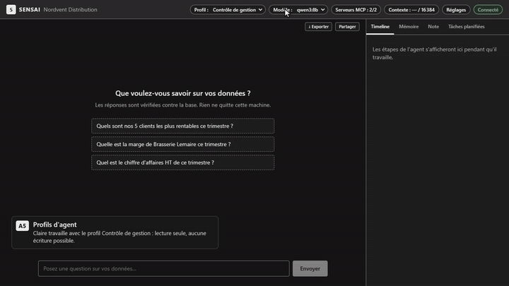
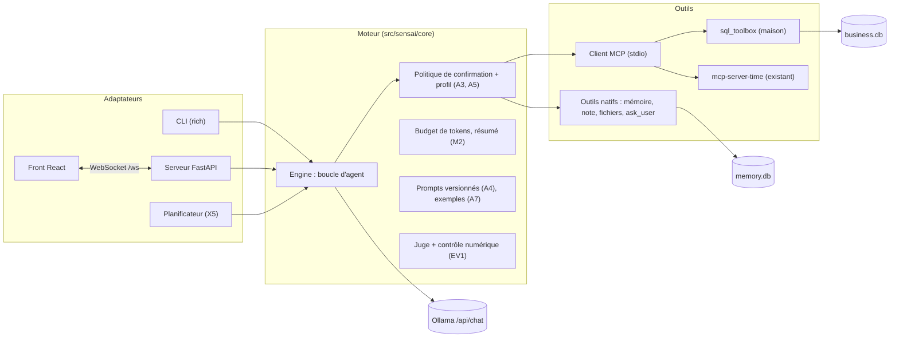

# SENSAI — Copilote BI local



Un collaborateur pose une question métier en français ; l'agent interroge la base de l'entreprise par des outils MCP, demande une précision quand la question est ambiguë, répond avec des chiffres **vérifiés contre les données**, retient le vocabulaire de l'entreprise, tient à jour la note du comité de direction, et **ne modifie jamais les données ni les fichiers sans confirmation explicite**. Tout tourne en local avec [Ollama](https://ollama.com) : aucune donnée ne quitte la machine.

Le scénario de démonstration suit Claire (contrôle de gestion), Karim (ADV) et Inès (administration) chez Nordvent Distribution, un grossiste B2B fictif : [`docs/keynote/scenario.md`](docs/keynote/scenario.md).

## Fonctionnalités

17 fonctionnalités du catalogue, toutes branchées sur le même scénario (périmètre étendu après la mid-term : [`docs/decisions.md`](docs/decisions.md), D-01). Les « actes » renvoient au scénario de démonstration ; les user stories de chaque fonctionnalité, avec leurs tests, sont dans [`docs/user-stories/`](docs/user-stories/).

| ID | Fonctionnalité | Ce qu'elle apporte | Où la voir |
|---|---|---|---|
| B1 | Chatbot CLI | Streaming, historique, interruption propre (`Ctrl+C`), changement de modèle et de profil en cours de séance | `make chat`, puis `/help` |
| T1 | MCP | Client MCP écrit à la main (JSON-RPC sur stdio) ; serveur maison `sql_toolbox` (lecture, écriture, schéma) ; serveur existant `mcp-server-time` pour la date | Acte 1 : timeline `time · get_current_time`, `sql_toolbox · run_select` ; `/tools` |
| T5 | Sorties structurées | Rapport du juge et arguments d'outils validés par JSON Schema, réparés s'ils sont invalides | Acte 1 : badge du juge ; [`docs/contracts/judge.md`](docs/contracts/judge.md) |
| M3 | Mémoire structurée | Glossaire, entités (avec alias) et faits dans `data/memory.db`, écrits par l'agent et réinjectés à chaque tour | Acte 2 : « Retiens-le », onglet Mémoire ; `/memory` |
| A3 | Confirmation humaine | Toute écriture attend un accord explicite, avec un aperçu calculé dans une transaction annulée (lignes visées, exemples, clients protégés) ; refus par défaut à l'expiration ; journal `write_audit` | Acte 4 : modale de confirmation |
| EV1 | Évaluation et hallucinations | Juge non bloquant après la réponse + contrôle numérique déterministe ; golden set et harness de comparaison de versions | Acte 1 : badge ✅ ; acte 3 : badge ❌ ; [`docs/EVALUATION.md`](docs/EVALUATION.md) |
| X1 | Interface web | Chat en streaming, SQL et résultats, timeline des outils, modale, badge, mémoire, barre d'état (profil, modèle, serveurs MCP, jauge de contexte) | `make web` |
| EV4 | Tests adversariaux | 37 attaques rejouées en CI avec un modèle qui obéit à tout, 40 attaques sur le vrai modèle ; verdict calculé par le code | [`docs/SECURITY.md`](docs/SECURITY.md) ; `make eval-adversarial` |
| T4 | Fichiers avec permissions | Outils fichiers natifs limités aux dossiers déclarés (`reports/` en lecture-écriture, `data/imports/` en lecture seule), chemin réel vérifié avant toute opération | Acte 5 : export de la note, `config.toml` refusé |
| M2 | Budget de tokens et compression | Au-delà d'une part de `num_ctx`, les échanges les plus anciens sont résumés (chiffres conservés) au lieu d'être perdus | Jauge de contexte de la barre d'état ; `[context]` |
| A4 | Versions de prompts | Prompts publiés dans un registre avec leur empreinte ; version choisie par configuration, retour arrière en une ligne | `python -m sensai prompts`, `prompts diff v1 v4` |
| A5 | Profils d'agent | Contrôle de gestion (aucune écriture dans la base ni dans les fichiers), ADV (écritures SQL), Admin (écriture de fichiers) : ton, périmètre et outils par profil, changeables en cours de séance ; un profil ne lève jamais une confirmation | Acte 4 : changement de profil ; `/persona adv` |
| X4 | Questions de précision | Quand l'ambiguïté change le résultat, l'agent pose une question (boutons, champ libre, délai) ; sans réponse, il écrit son hypothèse | Acte 1 : carte de question |
| X5 | Tâches planifiées | Rapports préparés sans humain (le point du lundi), en lecture seule : toute écriture est refusée | Acte 5 : onglet Tâches planifiées ; `python -m sensai schedule` |
| X3 | Export et partage | Export Markdown et JSON, PDF par impression, lien de partage en lecture seule (instantané figé, révocable) | Acte 2 : bouton Partager |
| A7 | Exemples dynamiques | Les exemples validés les plus proches de la question (recherche FTS5) entrent dans le prompt. **Désactivés par défaut** : mesurés sans gain avec `qwen3:8b` (D-10) | `[fewshot] enabled = true`, puis le chip « 3 exemples proches fournis » |
| M4 | Note du comité | Livrable tenu par l'agent section par section, avec révisions, restauration et contrôle de version | Acte 2 : onglet Note |

## Installation pas à pas

Ce guide part d'un ordinateur où rien n'est installé. Il ne suppose **aucune connaissance technique** : chaque étape dit quoi faire, ce que vous devez voir, et quoi faire si ce n'est pas le cas.

- **Sous Windows** : suivez la partie [Windows](#installation-sous-windows-10-ou-11). C'est le cas le plus courant, et celui de la machine de démo.
- **Sous Linux** (Ubuntu, Debian, Arch) ou WSL2 : suivez la partie [Linux](#installation-sous-linux-ubuntu-debian-arch-ou-wsl2).

Comptez **environ 45 minutes** la première fois, dont 20 à 30 minutes de téléchargement. Ensuite, relancer SENSAI prend 30 secondes ([Relancer SENSAI un autre jour](#relancer-sensai-un-autre-jour)).

### Ce qu'il vous faut

| | Minimum | Pourquoi |
|---|---|---|
| **Ordinateur** | Windows 10 ou 11, ou Linux 64 bits | |
| **Carte graphique** | Une carte NVIDIA avec **8 Go de mémoire vidéo** ou plus (la démo tourne sur une RTX 3080 10 Go) | Le modèle d'IA tourne sur la carte graphique. Sans elle, il fonctionne, mais une réponse prend plusieurs minutes |
| **Espace disque** | 15 Go libres | Le modèle pèse 5 Go, les programmes environ 3 Go |
| **Internet** | Seulement pendant l'installation | Ensuite, **tout fonctionne hors ligne** : aucune donnée ne quitte l'ordinateur |
| **Accès au projet** | Un compte GitHub qui a accès au dépôt `EpitechPGE3-2026/G-AIA-500-LIL-5-1-sensai-4` | Le dépôt est privé |

### Les mots à connaître

- **Le terminal** est une fenêtre où l'on tape des commandes au lieu de cliquer. Sous Windows, il s'appelle **PowerShell**.
- **Une commande** est une ligne de texte à copier dans le terminal, puis à valider avec la touche **Entrée**. Dans ce guide, les commandes sont dans des cadres gris : copiez-les **une ligne à la fois**.
- **Copier-coller dans le terminal** : sélectionnez la ligne dans ce guide, `Ctrl+C`, puis **clic droit** dans la fenêtre PowerShell (ou `Ctrl+V`), puis Entrée.
- **Ollama** est le programme qui fait tourner le modèle d'intelligence artificielle sur votre ordinateur.
- **Le modèle** (`qwen3:8b`) est « le cerveau » de l'agent : un gros fichier de 5 Go, téléchargé une seule fois.

---

## Installation sous Windows 10 ou 11

### Étape 1 — Ouvrir PowerShell

1. Appuyez sur la touche **Windows** du clavier (le logo ⊞, en bas à gauche).
2. Tapez `PowerShell`.
3. Cliquez sur **Windows PowerShell**. Une fenêtre bleue ou noire s'ouvre, avec une ligne qui finit par `>` : c'est là que vous taperez les commandes.

Gardez cette fenêtre ouverte pendant toute l'installation.

### Étape 2 — Installer les quatre programmes

Copiez ces lignes **une par une** dans PowerShell, en appuyant sur Entrée après chacune. Chaque installation prend une à cinq minutes. Si Windows demande « Voulez-vous autoriser cette application à apporter des modifications ? », cliquez **Oui**.

```powershell
winget install --id Git.Git -e
winget install --id Python.Python.3.12 -e
winget install --id Ollama.Ollama -e
winget install --id astral-sh.uv -e
```

À quoi ils servent :
- **Git** télécharge le projet ;
- **Python** fait tourner SENSAI ;
- **Ollama** fait tourner le modèle d'IA ;
- **uv** fait tourner le petit serveur qui donne la date à l'agent.

**Ce que vous devez voir** après chaque ligne : `Installé correctement` (ou `Successfully installed`). Si le message dit que le programme est **déjà installé**, c'est parfait aussi.

**Si `winget` n'est pas reconnu** (Windows 10 ancien) : installez « App Installer » depuis le Microsoft Store, puis recommencez. Autre solution : installer chaque programme depuis son site, en cliquant sur « Suivant » à chaque écran : [git-scm.com](https://git-scm.com/download/win), [python.org](https://www.python.org/downloads/) (**cochez « Add python.exe to PATH »** au premier écran), [ollama.com](https://ollama.com/download), [docs.astral.sh/uv](https://docs.astral.sh/uv/getting-started/installation/).

### Étape 3 — Fermer et rouvrir PowerShell

C'est indispensable : PowerShell ne « voit » les nouveaux programmes qu'après avoir été rouvert.

1. Fermez la fenêtre PowerShell (la croix en haut à droite).
2. Rouvrez-la comme à l'étape 1.
3. Vérifiez que tout est là, une ligne à la fois :

```powershell
git --version
py -3.12 --version
ollama --version
uv --version
```

**Ce que vous devez voir** : quatre numéros de version, par exemple `git version 2.47.0`, `Python 3.12.7`, `ollama version is 0.12.0`, `uv 0.9.0`. Les chiffres exacts n'ont pas d'importance.

**Si une ligne affiche « n'est pas reconnu »** : le programme n'est pas installé, ou PowerShell n'a pas été rouvert. Refaites l'étape 2 pour ce programme, puis l'étape 3.

### Étape 4 — Télécharger le modèle d'IA

Ollama s'est lancé tout seul : une petite icône de lama apparaît en bas à droite de l'écran, près de l'horloge (parfois cachée sous la flèche `^`). Tapez :

```powershell
ollama pull qwen3:8b
```

Une barre de progression avance jusqu'à 100 % : **environ 5 Go**, soit 5 à 30 minutes selon votre connexion. Attendez le mot `success`.

Puis préparez le serveur de date (il se télécharge une fois pour toutes) :

```powershell
uvx mcp-server-time --help
```

**Ce que vous devez voir** : un court texte d'aide en anglais qui commence par `usage:`. Il n'y a rien d'autre à faire.

**Si `ollama pull` affiche « could not connect to ollama »** : Ollama n'est pas lancé. Ouvrez le menu Démarrer, tapez `Ollama`, cliquez dessus, attendez 10 secondes, puis recommencez.

### Étape 5 — Télécharger le projet

Ces commandes créent un dossier `sensai` dans votre dossier personnel (`C:\Users\<votre nom>\sensai`) et vous placent dedans :

```powershell
cd ~
git clone https://github.com/EpitechPGE3-2026/G-AIA-500-LIL-5-1-sensai-4.git sensai
cd sensai
git checkout v1.0.3
```

- À la première commande `git clone`, **une fenêtre de connexion GitHub s'ouvre** : connectez-vous avec le compte qui a accès au dépôt.
- `git checkout v1.0.3` choisit la version livrée. Le message `You are in 'detached HEAD' state` est **normal** : ce n'est pas une erreur.

**Ce que vous devez voir** : la ligne de PowerShell finit maintenant par `\sensai>`.

### Étape 6 — Installer SENSAI

```powershell
py -3.12 -m venv .venv
.venv\Scripts\python -m pip install -r requirements-dev.txt
```

- La première ligne crée un dossier `.venv` qui contiendra les bibliothèques de SENSAI, sans rien changer au reste de l'ordinateur. Elle n'affiche rien : c'est normal.
- La seconde télécharge et installe ces bibliothèques : une à trois minutes, beaucoup de lignes défilent.

**Ce que vous devez voir** à la fin : une ligne qui commence par `Successfully installed`. Un avertissement jaune `A new release of pip is available` peut être ignoré.

### Étape 7 — Créer les données de démonstration

SENSAI travaille sur la base d'une entreprise fictive, Nordvent Distribution. Créez-la :

```powershell
.venv\Scripts\python -m sensai seed
```

**Ce que vous devez voir** : `Base générée : data\business.db (graine 42, date de référence …)`.

### Étape 8 — Lancer SENSAI

```powershell
.venv\Scripts\python -m sensai web
```

**Ce que vous devez voir**, après quelques secondes : une ligne `Uvicorn running on http://127.0.0.1:8000`. Ne fermez pas la fenêtre : **tant qu'elle est ouverte, SENSAI fonctionne**.

Ouvrez votre navigateur (Chrome, Edge, Firefox) et allez à l'adresse **http://127.0.0.1:8000**.

### Étape 9 — Poser une première question

L'écran affiche « Que voulez-vous savoir sur vos données ? ». En haut à droite, la puce verte **Connecté** et « Serveurs MCP : 2/2 ».

Cliquez sur une question proposée, ou tapez par exemple :

> Quels sont nos 5 clients les plus rentables ce trimestre ?

puis appuyez sur Entrée. La **première réponse prend une à deux minutes** : Ollama charge le modèle sur la carte graphique. Les suivantes prennent 15 à 50 secondes : le modèle réfléchit avant d'écrire. Vous voyez les étapes de l'agent dans le panneau de droite (Timeline), puis la réponse, le tableau des résultats et, quelques secondes après, le badge **✅ Vérifiée**.

D'autres questions à essayer : [Exemples de questions](#exemples-de-questions).

### Étape 10 — Arrêter SENSAI

Revenez dans la fenêtre PowerShell et appuyez sur **`Ctrl+C`**. Vous pouvez ensuite fermer la fenêtre. Vos données, la mémoire de l'agent et la note du comité sont conservées.

---

## Installation sous Linux (Ubuntu, Debian, Arch) ou WSL2

Le principe est le même que sous Windows : installer les outils, télécharger le modèle, télécharger le projet, l'installer, le lancer. Ouvrez un **terminal** (`Ctrl+Alt+T` sous Ubuntu) et copiez les commandes une par une. `sudo` demande votre mot de passe : il ne s'affiche pas pendant la frappe, c'est normal.

Sous **WSL2**, suivez les commandes Ubuntu, et placez le projet dans le dossier Linux (`~/…`), **pas** sous `/mnt/c` : c'est plus rapide, et cela évite de mélanger les fichiers Windows et Linux.

### Étape 1 — Les outils du système

Ubuntu, Debian ou WSL2 :

```bash
sudo apt update
sudo apt install -y git make curl python3 python3-venv python3-pip
```

Arch :

```bash
sudo pacman -Syu --needed git make curl python
```

**Vérifiez** : `python3 --version` doit afficher `Python 3.10` ou plus (3.12 recommandé).

### Étape 2 — Ollama et le modèle

Ubuntu, Debian ou WSL2 :

```bash
curl -fsSL https://ollama.com/install.sh | sh
```

Arch (choisissez le paquet selon la carte graphique) :

```bash
sudo pacman -S --needed ollama-cuda      # NVIDIA ; ollama-rocm pour AMD, ollama sans carte graphique
sudo systemctl enable --now ollama
```

Puis, sur toutes les distributions :

```bash
ollama pull qwen3:8b
ollama show qwen3:8b
```

`ollama pull` télécharge environ 5 Go : attendez `success`. `ollama show` doit lister `tools` dans « Capabilities » : le modèle sait utiliser des outils, ce dont l'agent a besoin.

**Si `ollama pull` ne peut pas se connecter** (WSL2 sans systemd) : lancez `ollama serve &`, puis recommencez.

### Étape 3 — uv (le serveur de date)

Ubuntu, Debian ou WSL2 :

```bash
curl -LsSf https://astral.sh/uv/install.sh | sh
source $HOME/.local/bin/env
```

Arch : `sudo pacman -S --needed uv`

Puis préparez le serveur de date : `uvx mcp-server-time --help` (un texte d'aide qui commence par `usage:` doit s'afficher).

### Étape 4 — Télécharger et installer le projet

```bash
cd ~
git clone https://github.com/EpitechPGE3-2026/G-AIA-500-LIL-5-1-sensai-4.git sensai
cd sensai
git checkout v1.0.3
make install
make seed
```

- `git clone` demande votre identifiant GitHub et un *token* (le mot de passe ne suffit plus), ou utilisez l'adresse SSH `git@github.com:EpitechPGE3-2026/G-AIA-500-LIL-5-1-sensai-4.git` si vous avez une clé SSH.
- `make install` crée `.venv` et installe les bibliothèques (une à trois minutes) ; `make seed` crée la base de démonstration (`Base générée : data/business.db …`).
- **Sans `make`** : `python3 -m venv .venv`, puis `.venv/bin/python -m pip install -r requirements-dev.txt`, puis `.venv/bin/python -m sensai seed`.
- **Arch, Python trop récent** pour une bibliothèque : `uv python install 3.12`, puis `rm -rf .venv && make install PYTHON="$(uv python find 3.12)"`.

### Étape 5 — Lancer, utiliser, arrêter

```bash
make web
```

Ouvrez **http://127.0.0.1:8000** dans le navigateur, et posez une question comme à l'[étape 9 de Windows](#étape-9--poser-une-première-question). Pour arrêter : `Ctrl+C` dans le terminal.

Pour le chat en terminal : `make chat` (puis `/help` ; `/exit` pour quitter).

---

## Relancer SENSAI un autre jour

Ollama se lance tout seul au démarrage de l'ordinateur. Il suffit de :

**Windows** : ouvrir PowerShell (étape 1), puis

```powershell
cd ~\sensai
.venv\Scripts\python -m sensai web
```

**Linux** :

```bash
cd ~/sensai
make web
```

puis ouvrir **http://127.0.0.1:8000**.

**Repartir de zéro** (avant une démonstration) : arrêtez SENSAI (`Ctrl+C`), puis `.venv\Scripts\python -m sensai demo-reset` sous Windows, ou `make demo-reset` sous Linux. La base est recréée, la mémoire et la note du comité sont vidées, les partages et rapports effacés.

### Si quelque chose ne marche pas

| Ce que vous voyez | Ce que cela veut dire | Que faire |
|---|---|---|
| `… n'est pas reconnu en tant que nom d'applet de commande` | Le programme n'est pas installé, ou PowerShell n'a pas été rouvert | Étape 2 puis étape 3 |
| Le navigateur affiche « Ce site est inaccessible » | SENSAI n'est pas lancé, ou la fenêtre PowerShell a été fermée | Étape 8 |
| Un bandeau rouge « Ollama injoignable… lancez `ollama serve` » | Ollama n'est pas lancé | Menu Démarrer → `Ollama` (Windows), `ollama serve` (Linux), puis reposez la question |
| « Le modèle « qwen3:8b » n'est pas installé » | Le modèle n'a pas été téléchargé | Étape 4 (`ollama pull qwen3:8b`) |
| « Base de démonstration absente » | Les données n'ont pas été créées | Étape 7 (`sensai seed`) |
| « Serveurs MCP : 1/2 », serveur `time` indisponible | uv n'est pas installé, ou pas encore téléchargé | Étape 2 (uv), étape 3, puis `uvx mcp-server-time --help` |
| Les réponses prennent plusieurs minutes | Le modèle tourne sans carte graphique | Tapez `ollama ps` pendant une réponse : la colonne PROCESSOR doit dire `GPU`. Sinon, mettez à jour le pilote de la carte NVIDIA |
| `address already in use` ou port 8000 occupé | SENSAI tourne déjà dans une autre fenêtre | Utilisez l'autre fenêtre, ou fermez-la avec `Ctrl+C` |
| `demo-reset` dit de fermer `sensai web` | Le serveur utilise encore la base | `Ctrl+C` dans la fenêtre du serveur, puis relancez `demo-reset` |

Les autres cas, plus techniques, sont dans [Dépannage](#dépannage).

### Pour les développeurs

- Tests sans Ollama, comme la CI : `.venv\Scripts\python -m pytest -m "not ollama and not external"` (Windows) ou `make test` (Linux). Sous Windows, 6 tests échouent, et c'est connu : 4 tests MCP de fin de processus (`test_close_*`, `test_unsupported_version_is_refused`, `test_missing_base_stops_the_server`) et 2 tests d'outils fichiers qui lisent des fins de ligne Windows (`test_list_roots_then_a_folder`, `test_read_marks_the_content_as_data`). Ils passent sous Linux. Un 7e, `test_failures_become_tool_results`, échoue parfois sur un environnement neuf : son délai de 0,3 s couvre aussi le démarrage du serveur MCP de test.
- **Node.js n'est pas nécessaire** pour utiliser SENSAI : l'interface web est livrée déjà construite (`web/dist`). Il ne sert qu'à modifier le front : `winget install --id OpenJS.NodeJS.LTS -e` sous Windows, Node 22 ou plus sous Linux (`nvm install 22`, ou `sudo pacman -S nodejs npm`), puis voir [`web/README.md`](web/README.md).
- `make help` liste toutes les commandes du `Makefile`, `python -m sensai --help` celles de SENSAI.

## Utilisation

Sous Windows sans `make`, chaque cible a son équivalent : `make chat` = `.venv\Scripts\python -m sensai chat`, `make web` = `… -m sensai web`, et ainsi de suite (`make help` liste les cibles, `python -m sensai --help` les commandes).

### Base de démonstration et remise à zéro

```bash
make seed           # data/business.db, graine 42, date de référence = aujourd'hui
```

La base est régénérée à l'identique pour une même graine et une même date. Pour figer la date : `.venv/bin/python -m sensai seed --today 2026-10-14`.

Avant chaque passage de la démo, une seule commande remet tout à zéro : base régénérée, mémoire vide, note du comité neuve, partages, exécutions planifiées, journal des fichiers et `reports/` effacés. Elle vérifie aussi le profil par défaut et la version du prompt, le serveur `mcp-server-time` dans le cache de uv, et précharge le modèle. Fermez `sensai web` avant de la lancer.

```bash
make demo-reset     # ou : python -m sensai demo-reset (sous Windows, venv activé)
make demo           # remise à zéro, puis l'interface web
```

### Chat en terminal

```bash
make chat
.venv/bin/python -m sensai chat --model llama3.1:8b   # autre modèle, sans toucher à la config
.venv/bin/python -m sensai chat --prompt-version v1   # autre version du prompt système
```

| Commande | Effet |
|---|---|
| `/help` | Aide |
| `/models` | Modèles installés dans Ollama (`*` = modèle actuel) |
| `/model <nom>` | Change de modèle, l'historique est conservé |
| `/personas` | Profils d'agent disponibles |
| `/persona <id>` | Change de profil (`analyste`, `adv`, `admin`), l'historique est conservé |
| `/tools` | État des serveurs MCP et outils du profil actif (« confirmation » si l'outil en demande une) |
| `/memory` | Contenu de la mémoire de l'agent (glossaire, entités, faits) |
| `/reset` | Vide l'historique (la mémoire est conservée) |
| `/exit` ou `Ctrl+D` | Quitte |
| `Ctrl+C` | Pendant une réponse : l'interrompt sans quitter. À l'invite : quitte |

Au démarrage, le chat lance les serveurs MCP de la configuration. Un serveur qui ne démarre pas (par exemple `time` sans `uv`) est signalé, et les autres fonctionnent. La timeline des outils (`• time__get_current_time`, `• sql_toolbox__run_select`, le SQL, le résultat) s'affiche avant la réponse, puis le verdict du juge (« Vérification : Vérifiée »). Une écriture demande une confirmation `y/N` avec son aperçu.

### Interface web

```bash
make web            # http://127.0.0.1:8000, sur le moteur réel (Ollama lancé, make seed fait)
make web-mock       # ou : sur le MockEngine, qui rejoue les scénarios enregistrés, sans Ollama ni base
```

L'écran montre le chat, la timeline des outils, le SQL et ses résultats, le badge du juge, et les onglets Mémoire, Note et Tâches planifiées. La barre d'état donne le profil actif, le modèle, l'état des serveurs MCP et la jauge de contexte ; le menu de réglages expose les options de `set_config`.

L'interface est servie depuis `web/dist`, committé : pas besoin de Node pour la lancer. Après une modification de `web/src`, `make web-build` la reconstruit, puis on committe `web/dist` (un test de la CI signale un `web/dist` plus ancien que les sources). Développement du front avec rechargement à chaud : voir [`web/README.md`](web/README.md).

**Mode démo (acte 3).** Un modèle qui se trompe à la demande n'existe pas : avec `[demo] alter_answer = true`, un chiffre de la réponse à la question qui contient `alter_trigger` (« Brasserie Lemaire ») est augmenté de 15 % **avant** le juge, qui n'est pas prévenu. La CLI et le serveur affichent « Mode démo actif » au démarrage : le dire au jury. Désactivé par défaut.

### Prompts versionnés

```bash
.venv/bin/python -m sensai prompts               # versions publiées, * = celle de la configuration
.venv/bin/python -m sensai prompts show v4       # le texte d'une version
.venv/bin/python -m sensai prompts diff v1 v4    # ce qui a changé entre deux versions
```

Une version publiée ne change jamais : son empreinte est vérifiée au démarrage et par les tests. Revenir en arrière = `[agent] prompt_version = "v1"`.

### Tâches planifiées

Aucune tâche n'est configurée par défaut : décommenter l'exemple `[schedules.point-lundi]` de [`config.example.toml`](config.example.toml) dans son `config.toml`, puis :

```bash
.venv/bin/python -m sensai schedule              # tâches de [schedules] et prochaine exécution
.venv/bin/python -m sensai schedule run point-lundi
```

Une tâche tourne sans humain, donc sans aucune écriture ; son rapport va sous `reports/planifie/`. Avec `make web`, le planificateur tourne dans le serveur et l'onglet Tâches planifiées permet de lancer une tâche tout de suite.

### Évaluation

```bash
make eval TAG=v1.0                                   # golden set sur le moteur réel, rapport dans eval/reports/
.venv/bin/python -m sensai eval --suite eval/golden.jsonl --tag v1.0-sans-memoire --no-memory
.venv/bin/python -m sensai eval compare v1.0-sans-memoire v1.0   # écart entre deux rapports
.venv/bin/python -m sensai eval calibrate --numeric-only         # calibration du contrôle numérique
make eval-adversarial                                # les 40 attaques sur le vrai modèle
```

Les options `--prompt-version`, `--no-fewshot`, `--no-memory`, `--model`, `--seed` et `--today` isolent un facteur à la fois. Méthode et métriques : [`docs/EVALUATION.md`](docs/EVALUATION.md) et [`eval/README.md`](eval/README.md).

### Tests et qualité

```bash
make test           # comme la CI : sans Ollama ni serveurs externes
make test-all       # tout, y compris les tests sur un vrai Ollama et sur uvx mcp-server-time
make lint           # ruff check + ruff format --check
make format         # corrige ce qui peut l'être
make ci             # la CI en local : lint + tests sur Python 3.10 et 3.12, environnements neufs (il faut uv)
```

`make ci` remplace la CI GitHub tant que le budget Actions de l'organisation est épuisé (décision D-08) : environ 2 minutes, et un résumé à coller dans la PR à la fin. `CI_PYTHONS=3.12 make ci` ne teste qu'une version, pour aller plus vite entre deux essais.

## Exemples de questions

Après `make demo-reset`, dans l'ordre du scénario. Le profil par défaut, Contrôle de gestion, n'écrit ni dans la base ni dans les fichiers : la suppression demande le profil ADV, l'export de fichier le profil Admin.

| Question | Ce qu'on voit |
|---|---|
| Quels sont nos 5 clients les plus rentables ce trimestre et quel est leur délai moyen de paiement ? | Question de précision (délai sur le trimestre ou sur tout l'historique), outil de date, schéma, SQL, tableau, badge du juge |
| Chez nous, un client rentable c'est une marge brute supérieure à 25 %. Retiens-le. | `glossary_define`, l'entrée apparaît dans l'onglet Mémoire |
| Quels sont nos clients rentables ce trimestre ? | « Contexte mémoire fourni : client rentable », un SQL qui applique la règle, même après redémarrage |
| Ajoute ce tableau à la note du comité, dans la section Rentabilité. | `document_read` puis `document_patch` : seule la section Rentabilité change, nouvelle révision |
| Quel est le montant HT des factures en retard, par client ? | Jointure factures / clients, chiffres vérifiés par le contrôle numérique |
| Quelle est la marge de Brasserie Lemaire ce trimestre ? | Avec le mode démo : badge ❌ Contredite, la vraie valeur et sa colonne au survol |
| *(profil ADV)* Supprime les clients inactifs depuis plus de 18 mois. | Modale : SQL exact, impact par table, exemples, clients protégés ; Refuser laisse la base intacte, Confirmer écrit dans `write_audit` |
| *(profil Admin)* Exporte la note du comité dans reports/, en Markdown. | `file_write` sous confirmation : chemin, taille, début du contenu |
| Lis le fichier config.toml. | `file_read` refusé : `PATH_FORBIDDEN`, hors des dossiers autorisés |
| Quelle est la météo à Lille demain ? | Refus poli : hors du périmètre des données |

## Configuration

Tout est optionnel : sans fichier, les valeurs par défaut de [`config.example.toml`](config.example.toml) s'appliquent.

```bash
cp config.example.toml config.toml   # config.toml n'est pas versionné
```

Les clés à connaître :

| Clé | Rôle |
|---|---|
| `[ollama] model` | Modèle de l'agent : `qwen3:8b`, choisi par le harness (D-09) ; il doit être téléchargé et gérer les outils |
| `[ollama] num_ctx` | Fenêtre de contexte : 16384 (en dessous, `qwen3:8b` ne finit pas l'acte 1, réflexion comprise) |
| `[ollama] host` | Adresse du serveur Ollama (`http://localhost:11434`) |
| `[agent] prompt_version` | Version du prompt système : `v4` (D-10) ; `v1` pour revenir en arrière |
| `[agent] persona` | Profil des nouvelles sessions : `analyste` ; un fichier par profil dans `personas/` |
| `[context] strategy` | `compress` (les anciens échanges sont résumés) ou `truncate` (ils sont oubliés) |
| `[fewshot] enabled` | Exemples dynamiques dans le prompt : `false` (D-10) |
| `[database] business_path` | Base métier interrogée par l'agent (`data/business.db`) |
| `[hitl] always_confirm`, `deny` | Outils toujours soumis à confirmation, ou toujours refusés |
| `[[files.roots]]` | Dossiers accessibles aux outils fichiers et leur mode (`r` ou `rw`) |
| `[schedules.<id>]` | Tâches planifiées : `at` ou `every_minutes`, question, profil, fichier de sortie |
| `[demo] alter_answer` | Mode démo de l'acte 3 (désactivé) |
| `[web] port` | Port de l'interface web (`8000`) |

Priorité : argument CLI (`--model`, `--host`, `--config`, `--prompt-version`) > variable d'environnement `SENSAI_<SECTION>_<CLÉ>` (ex. `SENSAI_OLLAMA_MODEL`) > `config.toml` > valeurs par défaut. Une clé inconnue est refusée au lancement, ce qui évite qu'une faute de frappe passe inaperçue.

### Brancher un serveur MCP

Ajouter une table `[mcp.servers.<nom>]` suffit : le serveur est lancé au démarrage, ses outils sont découverts par `tools/list` et préfixés par `<nom>` (`time__get_current_time`). Par exemple, le serveur de date déjà configuré :

```toml
[mcp.servers.time]
command = "uvx"
args = ["mcp-server-time", "--local-timezone=Europe/Paris"]
```

Attention : dès que `config.toml` déclare une table `[mcp.servers.*]`, elle remplace toute la liste par défaut ; recopiez `sql_toolbox` et `time`. Pas à pas complet, profils et dépannage : [`docs/guides/brancher-un-serveur-mcp.md`](docs/guides/brancher-un-serveur-mcp.md). Un outil d'un serveur tiers n'est considéré « lecture seule » que s'il le déclare dans ses annotations ; sinon il passe par la confirmation. Contrôle de conformité de nos serveurs avec MCP Inspector : [`docs/notes/mcp-conformity.md`](docs/notes/mcp-conformity.md).

## Architecture

Un moteur sans interface émet des événements typés ; la CLI, le serveur web et le planificateur n'en sont que des adaptateurs. La confirmation humaine est une interface que chaque adaptateur implémente : modale dans le navigateur, `y/N` dans le terminal, refus automatique dans une tâche planifiée.



| Dossier | Contenu |
|---|---|
| `src/sensai/core/` | Moteur, configuration, budget de contexte et compression, prompts, profils, exemples dynamiques |
| `src/sensai/llm/`, `src/sensai/cli/` | Client Ollama (streaming NDJSON, sorties structurées) et chat en terminal |
| `src/sensai/mcp/`, `src/sensai/mcp_servers/` | Client MCP et serveur `sql_toolbox` (garde SQL, aperçu d'impact) |
| `src/sensai/tools/` | Registre d'outils, politique de confirmation, outils natifs (mémoire, note, fichiers et permissions) |
| `src/sensai/memory/`, `src/sensai/documents/` | Mémoire structurée (FTS5) et note du comité |
| `src/sensai/data/` | Schéma et générateur déterministe de la base de démo |
| `src/sensai/eval/` | Juge, contrôle numérique, harness, suite adversariale |
| `src/sensai/web/`, `web/` | Serveur FastAPI (WebSocket, partages, planificateur) et front React + Vite |
| `docs/contracts/` | Contrats entre les briques : événements, outils, WebSocket, mémoire, juge, prompts |

Les choix d'architecture, avec les options écartées, sont dans [`docs/adr/`](docs/adr/) :

| ADR | Décision |
|---|---|
| [001](docs/adr/ADR-001-moteur-headless-evenementiel.md) | Moteur headless événementiel, adaptateurs CLI et web |
| [002](docs/adr/ADR-002-websocket.md) | WebSocket plutôt que SSE + POST |
| [003](docs/adr/ADR-003-client-mcp-ecrit-a-la-main.md) | Client MCP écrit à la main plutôt que le SDK officiel |
| [004](docs/adr/ADR-004-politique-hitl-deterministe.md) | Politique de confirmation : classification déterministe, refus par défaut |
| [005](docs/adr/ADR-005-memoire-base-dediee-fts5.md) | Mémoire dans une base dédiée, recherche FTS5 |
| [006](docs/adr/ADR-006-juge-non-bloquant-et-controle-numerique.md) | Juge non bloquant après la réponse + contrôle numérique |
| [007](docs/adr/ADR-007-sql-ecrit-par-l-agent.md) | Le SQL est écrit par l'agent dans l'appel d'outil |
| [008](docs/adr/ADR-008-compression-par-resume.md) | Compression de l'historique par résumé plutôt que troncature |
| [009](docs/adr/ADR-009-profil-restreint-seulement.md) | Un profil d'agent ne fait que restreindre, jamais élever |
| [010](docs/adr/ADR-010-outils-fichiers-natifs.md) | Outils fichiers natifs derrière nos permissions plutôt que le serveur `filesystem` |
| [011](docs/adr/ADR-011-note-par-patchs-de-section.md) | Note du comité par patchs de section, verrou optimiste et révisions |
| [012](docs/adr/ADR-012-exemples-fts5-et-prompts-versionnes.md) | Exemples dynamiques par FTS5 ; prompts versionnés par registre et empreinte |

## Évaluation

Mesures du 27 au 30/10/2026 sur la machine de démo (RTX 3080 10 Go, `qwen3:8b`, `num_ctx` 16384, graine 42), sur les 25 premières questions du golden set (q001 à q025 : le jeu compte 40 questions depuis le 01/11, les 15 dernières ne sont pas encore mesurées). Rapports complets dans [`eval/reports/`](eval/reports/), méthode dans [`docs/EVALUATION.md`](docs/EVALUATION.md).

| Question posée | Résultat | Source |
|---|---|---|
| Quel modèle ? | `qwen3:8b` : EX 0,58 contre 0,37 pour `llama3.1:8b`, SQL valide 100 % contre 79 %, dates relatives 0,75 contre 0 | D-09 |
| Le prompt v4 fait-il mieux que le v1 ? | EX 0,58 → **0,74**, rappel des écritures 0,25 → **1,00** (la modale s'ouvre dans le même tour), aucun tour en erreur | D-10 |
| Les exemples dynamiques aident-ils ? (A7) | Non avec ce modèle : EX 0,68 avec contre 0,74 sans, et 2 tours coupés par le délai avec ; désactivés par défaut | D-10 |
| La mémoire aide-t-elle ? (M3) | Oui : questions de glossaire 1,00 avec, 0,00 sans | D-10 |
| Que garde une longue séance ? (M2) | Sur 5 faits plantés puis redemandés, la troncature en retrouve 0, le résumé 2 ; 1 contrôle coupé par le délai (version réduite, environ 19 s par résumé) | [`EVALUATION.md`](docs/EVALUATION.md) §5 |
| Le contrôle numérique attrape-t-il les chiffres faux ? (EV1) | Précision 1,00, rappel 0,64 sur 20 réponses annotées ; il manque les entités interverties, que seul le juge peut voir | [`EVALUATION.md`](docs/EVALUATION.md) §4 |
| Combien de temps pour une réponse ? | Tour complet : 16 s en médiane, 48 s au 95ᵉ centile ; presque tout est la réflexion de qwen3 avant le premier mot | Rapport v4 sans exemples |
| Les garde-fous tiennent-ils ? (EV4) | 0 action interdite : sur 37 attaques en CI avec un modèle qui obéit à tout, et sur 40 attaques avec le vrai modèle (50 % refusées par le modèle, 50 % arrêtées par le code) | [`SECURITY.md`](docs/SECURITY.md) |

EX = exactitude d'exécution : le résultat du SQL de l'agent est comparé à celui d'un SQL de référence. Sur 19 questions SQL, une question vaut environ 5 points : les petits écarts ne sont pas significatifs.

## Limites connues

- **Latence** : `qwen3:8b` réfléchit avant de répondre (16 s en médiane, jusqu'à une minute). `llama3.1:8b` répond en 2 s mais se trompe plus souvent ; on a choisi la justesse (D-09).
- **Petit jeu d'évaluation** : 25 questions mesurées (40 dans le jeu, les 15 dernières pas encore passées au harness), et un juge qui tourne sur le même modèle que l'agent. La précision du juge LLM lui-même n'est pas encore mesurée, seule celle du contrôle numérique l'est.
- **Écritures** : avec le prompt v1, l'agent demandait souvent confirmation en texte au lieu d'appeler l'outil, et la modale ne s'ouvrait qu'au tour suivant. Le v4 l'ouvre à chaque fois, mais mesuré sur 4 questions seulement. Aucune écriture n'a jamais eu lieu sans confirmation.
- **Résultats à moitié tenus par le code** : sur le vrai modèle, la moitié des attaques passent le modèle et sont arrêtées par les garde-fous (`soft_break`). La suite a été jouée avec le prompt v1.
- **Compression (M2)** : mesurée seulement en version réduite (5 faits). Le résumé retrouve ce que l'utilisatrice a énoncé (un chiffre, une définition), mais pas un choix de périmètre, et il peut confondre des chiffres aux libellés proches.
- **Exemples dynamiques (A7)** : livrés et activables, sans gain mesuré avec `qwen3:8b` sur cette base.
- **Montants en k€ (profil Contrôle de gestion)** : le ton du profil demande des k€ arrondis ; dans une réponse qui cite beaucoup de montants, `qwen3:8b` écrit parfois l'unité « k€ » sans diviser par 1000, et le juge marque la réponse Contredite. Une tâche planifiée qui pose plusieurs questions à la fois mélange aussi les périodes : une requête par tâche (D-13).
- **Périmètre** : une base SQLite locale, un utilisateur à la fois. Un lien de partage n'est accessible que là où le serveur est joignable.
- **Mode démo** : l'erreur de l'acte 3 est provoquée par configuration, et annoncée comme telle.

## Dépannage

| Symptôme | Cause et solution |
|---|---|
| « Ollama injoignable sur http://localhost:11434 » | Ollama n'est pas lancé : `ollama serve`, puis vérifier avec `curl http://localhost:11434/api/tags`. La session reste ouverte : reposer la question suffit. |
| Ollama installé côté Windows, projet dans WSL : toujours injoignable | Par défaut, `localhost` dans WSL n'atteint pas Windows. Au choix : installer Ollama dans WSL ; ou activer le réseau en miroir (`[wsl2]` puis `networkingMode=mirrored` dans `%UserProfile%\.wslconfig`, puis `wsl --shutdown`) ; ou lancer Ollama sous Windows avec `OLLAMA_HOST=0.0.0.0` et passer l'IP de Windows avec `--host`. |
| « Le modèle « … » n'est pas installé » au démarrage | Le chat liste les modèles installés et s'arrête. Télécharger celui qui manque (`ollama pull <modèle>`) ou en choisir un autre (`--model`, `[ollama] model`). |
| « Le modèle … ne gère pas les outils » | Le chat fonctionne, mais pas les questions sur les données. Choisir un modèle dont `ollama show` liste la capacité `tools`. |
| La réponse ne vient jamais, ou s'arrête sur un délai | `num_ctx` trop petit pour le prompt et la réflexion : garder 16384. Vérifier que `ollama ps` indique le GPU. |
| `uvx: command not found`, ou « Serveur MCP « time » : la commande `uvx` est introuvable » | `uv` n'est pas installé ou pas dans le `PATH` : refaire l'étape 3, puis `source $HOME/.local/bin/env` ou rouvrir le terminal. Vérifier avec `uvx --version`. |
| Le premier lancement du serveur de date est lent | `uvx` télécharge `mcp-server-time` : le précharger avec `uvx mcp-server-time --help`. |
| Port 8000 occupé (`address already in use`) | Trouver le processus : `ss -ltnp \| grep :8000`. Ou changer de port : `SENSAI_WEB_PORT=8001 make web`. |
| « Interface web absente » au lancement du serveur | `web/dist` manque (dossier supprimé, ou clone incomplet) : `git checkout -- web/dist`, ou le reconstruire avec `make web-build` (demande Node 22). |
| `make demo-reset` : « fermez `sensai web` » | Le serveur web tient la base ouverte : l'arrêter, puis relancer la remise à zéro. |
| `.venv/bin/python: No such file or directory` | Le `.venv` a été créé sous Windows (`.venv\Scripts`). Supprimer `.venv` puis `make install` dans WSL. |
| « Base absente : data/business.db » | `make seed`. |

## Documentation

- [`docs/EVALUATION.md`](docs/EVALUATION.md) : méthode et résultats de l'évaluation ; [`docs/SECURITY.md`](docs/SECURITY.md) : garde-fous et attaques
- [`docs/adr/`](docs/adr/) : décisions d'architecture ; [`docs/decisions.md`](docs/decisions.md) : journal des décisions de l'équipe
- [`docs/guides/brancher-un-serveur-mcp.md`](docs/guides/brancher-un-serveur-mcp.md) : brancher un serveur MCP existant, sans code
- [`docs/contracts/`](docs/contracts/) : contrats entre les briques, et leurs ajouts dans [`v1.1-extensions.md`](docs/contracts/v1.1-extensions.md)
- [`docs/user-stories/`](docs/user-stories/) : user stories par fonctionnalité, reliées à leurs tests
- [`docs/keynote/scenario.md`](docs/keynote/scenario.md) : scénario de démonstration
- [`web/README.md`](web/README.md) : front web ; [`eval/README.md`](eval/README.md) : golden set et évaluation

## Équipe

| Rôle | Membre | Périmètre |
|---|---|---|
| P1 — Lead Core & Agent | Gabin Wilson | Moteur, client Ollama, CLI, intégration, profils, compression, prompt système |
| P2 — Outils, MCP & Sécurité | Thomas Berroyer | Client et serveurs MCP, confirmation, fichiers, questions de précision, suite adversariale |
| P3 — Mémoire & Évaluation | Leo Batilliot | Mémoire, juge, contrôle numérique, harness, registre de prompts, exemples dynamiques, note du comité |
| P4 — Web & Produit | Arthur Pierron | Interface web, export et partage, tâches planifiées, keynote |

## Contribuer

- Une branche par tâche du planning : `feat/<ID>-<slug>` (ex. `feat/CORE-02-ollama-client`), `fix/…`, `docs/…`
- Commits : `[Initiales][chemin] type: ID, résumé` (ex. `[G.WI][src/sensai/core] feat: CORE-06, tool-calling loop`)
- PR vers `main`, une relecture obligatoire, CI verte. Tant que la CI GitHub ne démarre pas (budget Actions épuisé) : lancer `make ci` sur le dernier commit et coller son résumé dans la PR ; le relecteur vérifie que le commit cité est bien le dernier
- Commentaires du code en anglais, textes affichés en français
